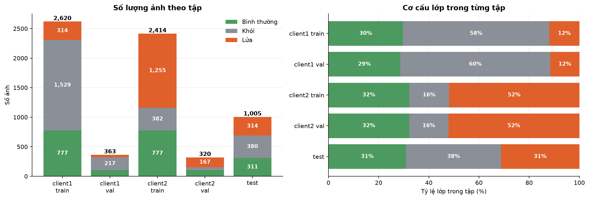
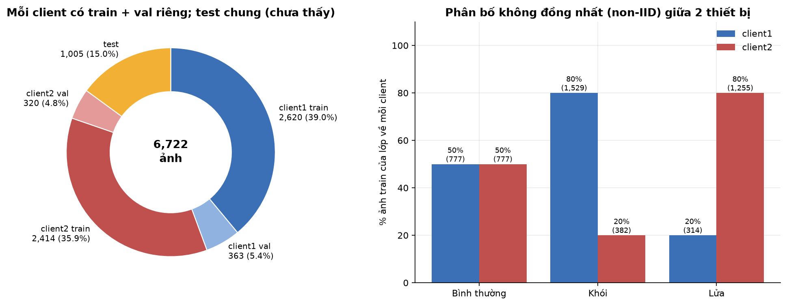
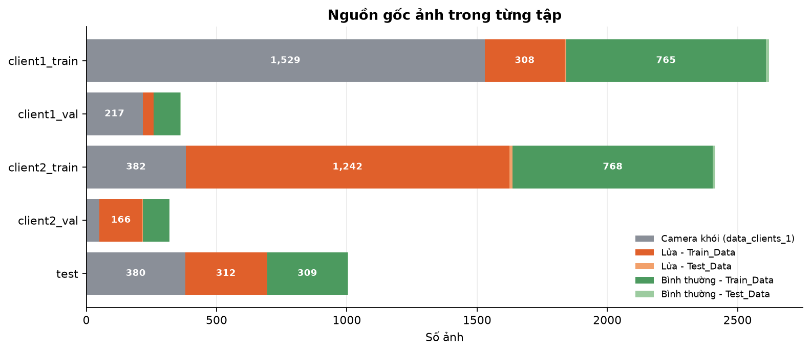
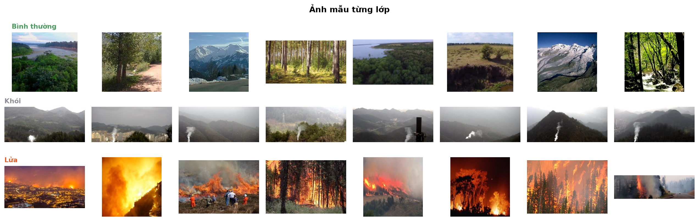
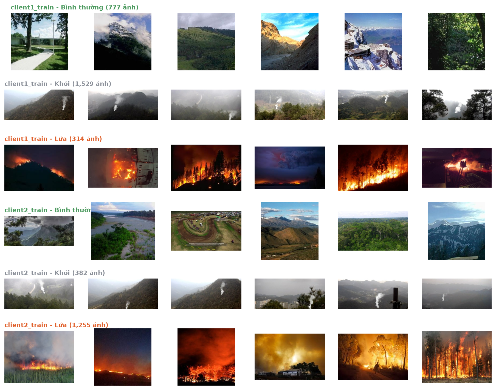

# Báo cáo dữ liệu

## 1. Mục tiêu

Báo cáo mô tả bộ dữ liệu ảnh dùng cho testbed học liên kết (FL) gồm hai thiết bị biên (iot1, iot2), một UAV chuyển tiếp và một trạm gốc (BS). Bài toán là phân loại ảnh thành ba lớp: **bình thường**, **khói**, **lửa**. Mỗi thiết bị chỉ giữ dữ liệu của mình, huấn luyện cục bộ, rồi trọng số được tổng hợp qua FedAvg. Bộ kiểm tra riêng (test) chưa từng xuất hiện ở bất kỳ thiết bị nào và chỉ dùng để đánh giá mô hình sau khi hai thiết bị đã tổng hợp và cập nhật lại trọng số.

Báo cáo trình bày nguồn dữ liệu, cách làm sạch, cách chia tập, mức độ lệch phân bố giữa hai thiết bị, đặc điểm của ảnh, và các hạn chế cần lưu ý khi đọc kết quả huấn luyện.

## 2. Nguồn dữ liệu

| Nguồn | Nội dung | Số file gốc | Lớp gán |
|---|---|---|---|
| Camera khói (thư mục `train-smoke`) | Khung hình video từ camera giám sát cố định ở vùng đồi núi, đều có khói | 10.230 | Khói |
| Ảnh lửa (`Train_Data/Fire`, `Test_Data/Fire`) | Ảnh cháy rừng và cháy công trình từ nhiều nguồn | 2.525 | Lửa |
| Ảnh không cháy (`Train_Data/Non_Fire`, `Test_Data/Non_Fire`) | Phong cảnh, rừng, núi tuyết, sông, đường mòn | 2.525 | Bình thường |
| Ảnh flycam (`test_big`) | 2.007 ảnh chụp từ trên không, không có nhãn | 2.007 | Không dùng |

Toàn bộ nguồn khói chỉ có khói. Hai nguồn còn lại cung cấp lớp lửa và lớp bình thường. Ảnh lửa thường chứa cả khói nhưng vẫn gán nhãn lửa, tức bài toán được đặt dưới dạng đơn nhãn với ưu tiên lửa.

## 3. Làm sạch dữ liệu

Các bước đã thực hiện để tạo thư mục dữ liệu chuẩn `data/clients`:

| Bước | Kết quả |
|---|---|
| Bỏ ảnh không mở được | 389 ảnh lửa hỏng |
| Bỏ ảnh trùng hệt nội  | 453 ảnh bình thường (khoảng 18% thư mục `Non_Fire`) và 44 ảnh lửa |
| Bỏ ảnh không nhãn | 2.007 ảnh `test_big` |
| Thưa khung hình khói | Lấy 1 trên 4 khung, từ 10.230 còn 2.558 ảnh, vì các khung liền nhau gần giống hệt |
| Cắt dải chữ trên ảnh khói | Bỏ 10% phía trên và 12% phía dưới ảnh, nơi camera in ngày giờ và địa danh |
| Thu nhỏ ảnh | Cạnh dài tối đa 320 px, giữ tỷ lệ khung hình |

Sau làm sạch còn **6.722 ảnh** (2.072 bình thường, 2.558 khói, 2.092 lửa), tất cả là JPEG, chế độ màu RGB, đều đọc được, tổng dung lượng 107 MB. Chiều rộng ảnh từ 148 đến 320 px (trung vị 320), chiều cao từ 66 đến 320 px (trung vị 180).

## 4. Cách chia tập

Mỗi thiết bị có tập huấn luyện (train) và tập kiểm định (val) riêng. Tập test chung nằm ngoài cả hai thiết bị.

| Tập | Bình thường | Khói | Lửa | Tổng | Tỷ lệ |
|---|---|---|---|---|---|
| client1 train | 777 | 1.529 | 314 | 2.620 | 39,0% |
| client1 val | 104 | 217 | 42 | 363 | 5,4% |
| client2 train | 777 | 382 | 1.255 | 2.414 | 35,9% |
| client2 val | 103 | 50 | 167 | 320 | 4,8% |
| test (chưa thấy) | 311 | 380 | 314 | 1.005 | 15,0% |
| **Cộng** | 2.072 | 2.558 | 2.092 | 6.722 | 100% |

Gộp theo vai trò: train 5.034 ảnh (74,9%), val 683 ảnh (10,2%), test 1.005 ảnh (15,0%).

Nguyên tắc chia:
- Test lấy khoảng 15% mỗi lớp và val khoảng 10% mỗi lớp từ tổng, phần còn lại là train. Val chung này sau đó được chia về hai thiết bị theo đúng tỷ lệ lệch của train, nên cơ cấu lớp của val mỗi thiết bị khớp với train của thiết bị đó.
- Ảnh khói chia theo khối 50 khung hình liền nhau: các khung gần giống hệt nằm cùng một tập, tránh việc khung liền kề vừa ở train vừa ở test.
- Ảnh bình thường chia đều hai thiết bị; ảnh lửa và khói chia lệch (mục 5).

*Hình 1. Số lượng ảnh theo tập (trái) và cơ cấu lớp trong từng tập (phải).*

*Hình 2. Mỗi thiết bị có train và val riêng, test dùng chung (trái); tỷ lệ ảnh train của từng lớp về mỗi thiết bị (phải).*

## 5. Phân bố không đồng nhất giữa hai thiết bị (non-IID)

Dữ liệu được cố ý chia lệch để phản ánh tình huống thực tế: thiết bị đặt ở nơi hay gặp khói thì có nhiều ảnh khói, thiết bị đặt ở nơi hay xảy ra cháy thì có nhiều ảnh lửa. Cả hai thiết bị vẫn thấy đủ ba lớp để học được ranh giới giữa các lớp.

| Lớp | client1 train | client2 train | Tỷ lệ về client1 |
|---|---|---|---|
| Bình thường | 777 | 777 | 50% |
| Khói | 1.529 | 382 | 80% |
| Lửa | 314 | 1.255 | 20% |

Cơ cấu lớp trong train mỗi thiết bị:

| Thiết bị | Bình thường | Khói | Lửa |
|---|---|---|---|
| client1 | 29,7% | 58,4% | 12,0% |
| client2 | 32,2% | 15,8% | 52,0% |

Client1 nghiêng về khói, client2 nghiêng về lửa. Test cân bằng hơn (31% bình thường, 38% khói, 31% lửa), nên phép đo sau tổng hợp phản ánh khả năng tổng quát của mô hình chung chứ không thiên về thiết bị nào.

Nguồn gốc ảnh trong từng tập cho thấy các nguồn được trộn đều giữa val, train và test, ngoại trừ ảnh khói luôn đến từ cùng camera:

*Hình 3. Nguồn gốc ảnh trong từng tập.*

## 6. Đặc điểm của ảnh

Ảnh mẫu của từng lớp:

*Hình 4. Ảnh mẫu từng lớp: bình thường (phong cảnh, rừng, núi tuyết), khói (cột khói trắng mảnh trên nền đồi núi sương mù), lửa (đám cháy cam đỏ, thường kèm khói đen).*

*Hình 5. Ảnh mẫu trong train của mỗi thiết bị, theo từng lớp.*

Số liệu thị giác trung bình theo lớp (tính trên ảnh đã chuẩn hóa về cạnh dài 320 px):

| Lớp | Rộng | Cao | Độ sáng | Tương phản | Độ bão hòa | Độ nét | Tỷ lệ màu nóng | Tỷ lệ xám sáng |
|---|---|---|---|---|---|---|---|---|
| Bình thường | 285 | 247 | 105,5 | 53,6 | 88,4 | 1.769 | 0,006 | 0,136 |
| Khói | 320 | 140 | 118,5 | 64,4 | 27,0 | 282 | 0,000 | 0,327 |
| Lửa | 281 | 202 | 85,4 | 48,7 | 140,0 | 1.139 | 0,141 | 0,058 |

Nhận xét:
- Lửa có độ bão hòa cao nhất (140) và nhiều điểm ảnh màu nóng (14,1%), tối hơn các lớp khác (độ sáng 85,4).
- Khói có độ bão hòa thấp nhất (27), nhiều điểm ảnh xám sáng nhất (32,7%), độ nét thấp nhất (282) vì khói và sương mù làm mờ ảnh, và hầu như không có màu nóng.
- Lớp bình thường nằm giữa, độ nét cao nhất (1.769) do chi tiết cảnh vật phong phú.

Số liệu theo tập, cho thấy mỗi thiết bị mang đặc điểm riêng và test nằm giữa hai thiết bị:

| Tập | Rộng | Cao | Độ sáng | Tương phản | Độ bão hòa | Độ nét | Màu nóng | Xám sáng |
|---|---|---|---|---|---|---|---|---|
| client1 train | 304 | 179 | 110,9 | 58,7 | 58,6 | 829 | 0,017 | 0,242 |
| client1 val | 306 | 179 | 109,8 | 62,0 | 58,7 | 837 | 0,017 | 0,226 |
| client2 train | 288 | 207 | 97,8 | 53,0 | 106,0 | 1.183 | 0,080 | 0,127 |
| client2 val | 288 | 207 | 95,3 | 52,1 | 108,2 | 1.250 | 0,070 | 0,129 |
| test | 297 | 192 | 102,7 | 56,4 | 79,2 | 1.034 | 0,043 | 0,177 |

Val của mỗi thiết bị có đặc điểm thị giác rất gần train của thiết bị đó, nên val phản ánh đúng phân bố cục bộ. Test có các chỉ số nằm giữa hai thiết bị, đúng với vai trò kiểm tra mô hình chung.

## Phụ lục: tệp dữ liệu và cách tái tạo

| Đường dẫn | Nội dung |
|---|---|
| `data/clients/{client1,client2}/{train,val}/<lớp>/` | Ảnh train và val của từng thiết bị |
| `data/clients/test/<lớp>/` | Ảnh test chung |
| `data/clients/manifest.csv` | Mỗi ảnh thuộc tập nào, lớp nào, nguồn gốc ban đầu |
| `src/data_understanding/run_all.py` | Chạy phân tích và vẽ hình |
| `outputs/data_understanding/analysis/` | Bảng số liệu (CSV, JSON) |
| `outputs/data_understanding/bao_cao_so_lieu.md` | Số liệu tóm tắt do chương trình tạo |
