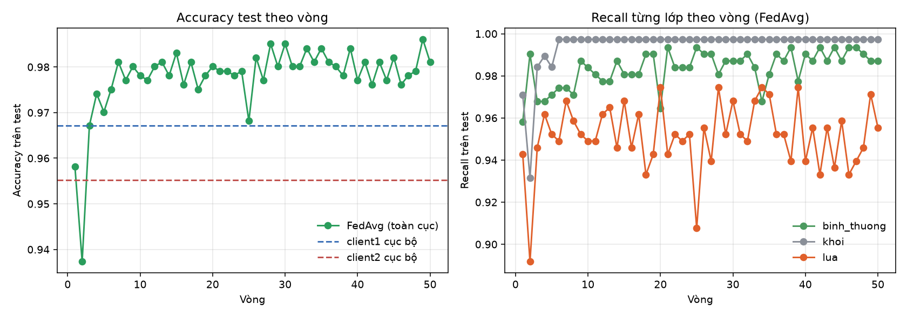

# Báo cáo học liên kết FedAvg giữa hai client

## 1. Mục tiêu và phạm vi

Báo cáo trình bày kết quả học liên kết (FedAvg) giữa hai client, mỗi client chỉ có dữ liệu lệch của mình, và so sánh mô hình toàn cục với hai mô hình cục bộ đã nêu ở `bao_cao_huan_luyen_mo_hinh.md`. Câu hỏi cần trả lời: tổng hợp trọng số có bù được điểm yếu của từng mô hình cục bộ (lửa ở client1, khói ở client2) hay không, bao nhiêu vòng là đủ, và chi phí truyền thông là bao nhiêu.

Phạm vi: FedAvg không mã hóa, hai client chạy lần lượt trong MỘT tiến trình trên máy chủ, tiến trình này nằm trong giả lập Pi 4 (1,6 nhân, trần bộ nhớ commit 4 GB; chỉ giới hạn số nhân và RAM). Chưa có: mã hóa đồng cấu, kênh UAV, kết quả nhiều seed (xem `bao_cao_so_sanh_nhieu_seed.md`).

## 2. Thiết lập

### 2.1 Mô hình và dữ liệu

Mô hình, dữ liệu và chia tập giống báo cáo huấn luyện: SqueezeNet 1.1 đóng băng thân, chỉ huấn luyện lớp phân loại cuối (1.539 tham số); client1 có 2.620 ảnh train, client2 có 2.414 ảnh train; test 1.005 ảnh dùng chung. Hai client khởi tạo cùng một mô hình toàn cục (ImageNet cho thân, cùng đầu phân loại khởi tạo với seed 42).

### 2.2 Thuật toán

Mỗi vòng:
1. Server gửi trọng số toàn cục xuống hai client.
2. Mỗi client huấn luyện cục bộ 1 epoch trên dữ liệu của mình.
3. Hai client gửi trọng số lên; server lấy trung bình có trọng số theo số ảnh: w = (n1·w1 + n2·w2)/(n1 + n2), tức 0,5205 cho client1 và 0,4795 cho client2.

| Tham số | Giá trị | Nguồn |
|---|---|---|
| Số client | 2 | Đề án |
| Số vòng | 50 | Đề án (bài báo dùng 10; kết quả sau vòng 10 cũng được nêu để đối chiếu) |
| Epoch cục bộ mỗi vòng | 1 | Bài báo (cấu hình phần cứng thật) |
| Trình tối ưu cục bộ | SGD, lr 0,01 không đổi, không momentum, không weight decay | Bài báo (không dùng StepLR trong từng vòng) |
| Kích thước lô | 64 | Đề án |
| Hàm mất mát | Cross-entropy | Bài báo |

Mô hình cuối là mô hình toàn cục ở vòng cuối (vòng 50), không chọn vòng tốt nhất theo test. Tập test chỉ dùng để theo dõi từng vòng và chấm điểm cuối. Vì cùng seed và cùng cách xáo dữ liệu theo vòng, 10 vòng đầu của lượt chạy 50 vòng trùng hoàn toàn với lượt chạy 10 vòng riêng trước đó, nên kết quả "10 vòng" dưới đây chính là trạng thái sau vòng 10 của cùng một lượt chạy.


*Hình 1. Sơ đồ học liên kết: hai thiết bị gửi trọng số lớp cuối (khoảng 6 KB) lên máy chủ, máy chủ lấy trung bình có trọng số theo số ảnh rồi gửi xuống; mô hình toàn cục sau vòng cuối được chấm trên tập test chung.*

### 2.3 Các mốc so sánh

| Mốc | Mô tả |
|---|---|
| client1 cục bộ, client2 cục bộ | Mô hình mỗi client tự huấn luyện 150 epoch (báo cáo huấn luyện) |
| Trung bình 1 lần | Lấy trung bình trọng số (cùng hệ số n_k/n) của hai mô hình cục bộ đã huấn luyện xong, không có vòng nào |
| FedAvg | Huấn luyện liên kết như mục 2.2, nêu kết quả sau vòng 10 và sau vòng 50 |

## 3. Kết quả

### 3.1 So sánh trên tập test

| Mô hình | Accuracy | Macro-F1 | Loss | Recall bình thường | Recall khói | Recall lửa | Số ảnh sai |
|---|---|---|---|---|---|---|---|
| client1 cục bộ | 96,72% | 0,965 | 0,090 | 0,981 | 0,997 | 0,917 | 33 |
| client2 cục bộ | 95,52% | 0,955 | 0,104 | 0,968 | 0,934 | 0,968 | 45 |
| Trung bình 1 lần | 97,21% | 0,971 | không ghi | 0,987 | 0,984 | 0,943 | 28 |
| FedAvg sau vòng 10 | 97,81% | 0,977 | 0,069 | 0,984 | 0,997 | 0,949 | 22 |
| **FedAvg sau vòng 50 (mô hình cuối)** | **98,11%** | **0,980** | **0,062** | 0,987 | **0,997** | 0,955 | **19** |

Khoảng tin cậy 95% xấp xỉ của accuracy FedAvg vòng 50: 98,1% ± 0,8 điểm (xấp xỉ nhị thức; ảnh test không độc lập hoàn toàn nên khoảng thực tế rộng hơn).

Kết quả từng lớp của FedAvg sau vòng 50:

| Lớp | Precision | Recall | F1 |
|---|---|---|---|
| Bình thường | 0,956 | 0,987 | 0,972 |
| Khói | 0,995 | 0,997 | 0,996 |
| Lửa | 0,990 | 0,955 | 0,972 |

Ma trận nhầm lẫn của FedAvg sau vòng 50 trên test (hàng: thực tế, cột: dự đoán):

| | Bình thường | Khói | Lửa |
|---|---|---|---|
| Bình thường (311) | 307 | 1 | 3 |
| Khói (380) | 1 | 379 | 0 |
| Lửa (314) | 13 | 1 | 300 |


*Hình 2. Accuracy (trái; trục tung cắt từ 94% để thấy chênh lệch) và recall từng lớp (phải) của hai mô hình cục bộ, trung bình một lần và FedAvg 50 vòng trên tập test.*


*Hình 3. Ma trận nhầm lẫn của mô hình FedAvg sau vòng 50 trên tập test.*

### 3.2 Diễn biến theo vòng

Accuracy test tính trung bình theo từng khối vòng (độ lệch chuẩn tính trong khối):

| Khối vòng | Accuracy test trung bình | Độ lệch chuẩn | Thấp nhất | Cao nhất | Loss test trung bình |
|---|---|---|---|---|---|
| 1 đến 3 | 95,42% | 1,25 | 93,73% | 96,72% | 0,131 |
| 4 đến 10 | 97,60% | 0,37 | 96,82% | 98,01% | 0,073 |
| 11 đến 20 | 97,90% | 0,24 | 97,51% | 98,31% | 0,064 |
| 21 đến 30 | 97,93% | 0,44 | 96,82% | 98,51% | 0,065 |
| 31 đến 40 | 98,11% | 0,24 | 97,71% | 98,41% | 0,059 |
| 41 đến 50 | 97,98% | 0,30 | 97,61% | 98,61% | 0,066 |

Một số vòng tiêu biểu:

| Vòng | Val client1 | Val client2 | Accuracy test | Loss test |
|---|---|---|---|---|
| 0 (chưa huấn luyện) | không ghi | không ghi | 30,45% | không ghi |
| 1 | 95,0% | 97,5% | 95,82% | 0,144 |
| 2 | 91,7% | 96,2% | 93,73% | 0,157 |
| 5 | 98,0% | 98,1% | 96,81% | 0,081 |
| 10 | 98,8% | 97,8% | 97,81% | 0,069 |
| 20 | 99,1% | 97,8% | 98,00% | 0,058 |
| 30 | 98,8% | 98,1% | 98,50% | 0,058 |
| 40 | 98,8% | 96,8% | 97,71% | 0,066 |
| 50 | 98,8% | 97,5% | 98,10% | 0,062 |



*Hình 4. Accuracy test theo vòng (trái; hai đường nét đứt là accuracy của hai mô hình cục bộ) và recall từng lớp theo vòng (phải). Có một sụt ở vòng 2 và vòng 25; từ vòng khoảng 10 accuracy dao động quanh 98%.*

### 3.3 Chi phí truyền thông và thời gian

| Hạng mục | Giá trị |
|---|---|
| Tham số truyền mỗi vòng | 1.539 số thực 32 bit |
| Dung lượng mỗi chiều mỗi client mỗi vòng (dạng rõ) | 6.156 byte (khoảng 6 KB) |
| Tổng truyền lên mỗi client sau 10 vòng / 50 vòng | khoảng 61,6 KB / 307,8 KB |
| Thời gian chạy toàn bộ 50 vòng của hai client | khoảng 168 giây (khoảng 3,4 giây mỗi vòng), gồm cả đánh giá mỗi vòng, trong giả lập Pi 4 |
| Cả tiến trình `run_fedavg.py` (bằng chứng `outputs/device_runs/run_fedavg_<giờ>/`) | 176 giây thực, 189 giây CPU, trung bình 1,07 nhân; RAM vật lý đỉnh 649 MiB, bộ nhớ cam kết đỉnh 1.034 MiB (giới hạn 4.096 MiB); đây là của CẢ HAI client trong một tiến trình |

Giả lập Pi 4 chỉ giới hạn số nhân và RAM, không làm CPU chậm như Cortex-A72 1,5 GHz, nên thời gian vẫn nhanh hơn thiết bị thật và chưa quy đổi.

## 4. Phân tích

### 4.1 FedAvg tốt hơn cả hai mô hình cục bộ

Sau vòng 50, accuracy test tăng 1,4 điểm so với mô hình cục bộ tốt nhất (client1: 96,72% lên 98,11%) và 2,6 điểm so với client2 (95,52%). Số ảnh sai giảm từ 33 và 45 xuống 19. Điểm yếu của mỗi client được cải thiện:
- Recall khói (yếu của client2, 0,934) lên 0,997, bằng mức tốt nhất của client1.
- Recall lửa (yếu của client1, 0,917) lên 0,955.

### 4.2 FedAvg không vượt trội ở mọi lớp

Recall lửa của FedAvg (0,955) vẫn thấp hơn mô hình cục bộ của client2 (0,968), client này có nhiều ảnh lửa nhất (1.255). Lỗi còn lại tập trung ở một nhóm: 13 trong 19 ảnh sai (68%) là ảnh lửa bị nhầm thành bình thường. Phù hợp với quan sát ở báo cáo huấn luyện: nhóm này gồm đám cháy nhỏ, khói nhiều hơn lửa, và một số ảnh có nhãn đáng ngờ, nên khó cải thiện chỉ bằng tổng hợp trọng số.

### 4.3 Bao nhiêu vòng là đủ

Mô hình hội tụ nhanh và phẳng sau khoảng vòng 10 đến 11:
- Vòng 1 đã đạt 95,8%; 10 vòng đầu đưa accuracy từ 30% lên 97,8%.
- Từ vòng 11 trở đi accuracy trung bình mỗi khối chỉ nằm trong khoảng 97,9% đến 98,1%, không có xu hướng tăng rõ. Chênh lệch giữa vòng 10 (97,81%, 22 ảnh sai) và vòng 50 (98,11%, 19 ảnh sai) là 0,3 điểm, nhỏ hơn độ dao động giữa các vòng (độ lệch chuẩn khoảng 0,3 điểm), nên chưa đủ để khẳng định 40 vòng thêm có ích. Có thể kết luận rằng 10 vòng theo bài báo là đủ cho bài toán này, và kéo dài không gây hại.
- Không nên chọn vòng tốt nhất theo test (vòng 49 đạt 98,61%): đó là chọn theo dữ liệu kiểm tra, làm con số lạc quan. Mô hình cuối lấy ở vòng 50.

### 4.4 Trung bình một lần đã gần bằng FedAvg

Chỉ lấy trung bình hai mô hình cục bộ đã được 97,21%, và FedAvg 50 vòng đạt 98,11% (hơn 0,9 điểm, 9 ảnh). Lý do: thân đóng băng và hai client khởi tạo cùng đầu phân loại, nên bài toán tuyến tính trên cùng một không gian đặc trưng, trọng số hai mô hình nằm gần nhau và trung bình tốt. Với một seed, chênh lệch 9 ảnh nằm trong vùng dao động của phép đo nên chưa đủ để khẳng định lợi ích của các vòng liên kết. Kết quả nhiều seed (`bao_cao_so_sanh_nhieu_seed.md`) đã làm rõ: ở chế độ lớp cuối, FedAvg hơn trung bình một lần khoảng 1,0 điểm ở cả 5 seed, có ý nghĩa thống kê.

### 4.5 Ảnh hưởng của non-IID và độ ổn định

- Vòng 2 có sụt giảm (93,7%, val client1 còn 91,7%), dấu hiệu trôi lệch client do dữ liệu không đồng nhất: mỗi client học thêm một epoch trên dữ liệu lệch của mình nên trung bình tạm thời kém đi. Từ vòng 3 trở đi ổn định.
- Dao động nhỏ vẫn còn đến vòng 50 (ví dụ val client2 giảm xuống 96,8% ở vòng 40, accuracy test khối vòng 21 đến 30 có vòng thấp nhất 96,8%), vì tốc độ học 0,01 không giảm theo vòng. Nếu cần ổn định hơn có thể giảm tốc độ học theo vòng.

### 4.6 Chi phí truyền thông

Mỗi client chỉ truyền khoảng 6 KB mỗi vòng ở dạng rõ, rất nhỏ nhờ chỉ huấn luyện lớp cuối. Khi mã hóa đồng cấu, toàn bộ 1.539 tham số vừa một ciphertext CKKS (4.096 ô), kích thước khoảng 129 KB theo bảng đo của dự án, tức phình khoảng 21 lần so với dạng rõ; đây vẫn là chi phí nhỏ so với mã hóa cả mô hình (hàng chục đến hàng trăm ciphertext). Con số này cần đo lại trong testbed với tham số đã chốt.

## 5. Hạn chế

1. **Một seed, một lần chạy.** Dao động giữa các vòng khoảng 0,3 điểm; chênh lệch dưới 1 điểm giữa các phương pháp (FedAvg so với trung bình một lần, vòng 10 so với vòng 50) chưa đủ bằng chứng. Cần chạy nhiều seed để khẳng định.
2. **Tập test dùng chung không độc lập hoàn toàn với train** (ảnh khói là khung hình liên tiếp từ camera cố định), nên mọi con số có thể lạc quan hơn khả năng tổng quát.
3. **Test được dùng để theo dõi từng vòng.** Mô hình cuối không chọn theo test, nhưng người đọc cần biết test đã được xem nhiều lần.
4. **Chỉ có hai client** và kiểu non-IID là chia lệch 80/20 do đề án tự đặt, không phải phân phối Dirichlet như bài báo.
5. **Nhiễu nhãn và nguồn ảnh khói đơn lẻ**, như đã nêu ở báo cáo dữ liệu và báo cáo huấn luyện.
6. **Chưa có mã hóa, kênh UAV; giả lập Pi 4 chỉ giới hạn số nhân và RAM.** Hai client chạy chung một tiến trình nên dùng chung một giới hạn. Đây là kết quả của học liên kết thuần túy; chi phí bảo mật và truyền thông qua kênh vô tuyến chưa được tính.

## 6. Kết luận

- FedAvg với hai client, 1 epoch cục bộ mỗi vòng đạt accuracy test 97,81% sau 10 vòng và 98,11% sau 50 vòng (macro-F1 0,980), tốt hơn hai mô hình cục bộ (96,72% và 95,52%), giảm số ảnh sai từ 33 và 45 xuống 19.
- Mô hình hội tụ khoảng vòng 10 và phẳng sau đó; 10 vòng theo bài báo là đủ, 50 vòng chỉ thêm 0,3 điểm nằm trong vùng dao động.
- Tổng hợp trọng số bù được điểm yếu đối xứng của hai client (khói và lửa), nhưng lỗi lửa nhầm thành bình thường vẫn còn nhiều nhất (13 trên 19 ảnh sai).
- Mỗi vòng chỉ truyền khoảng 6 KB mỗi chiều mỗi client, thuận lợi cho mã hóa đồng cấu về sau.
- Cần chạy nhiều seed và so sánh với chế độ huấn luyện nhiều lớp hơn trước khi kết luận chắc chắn. Bước tiếp theo: quyết định chế độ huấn luyện, rồi dựng testbed với kênh UAV và mã hóa đồng cấu.

## Phụ lục: cách chạy lại

```
python src/model/run_fedavg.py
```

Script tự áp giới hạn Pi 4 khi khởi động và ghi bằng chứng vào `outputs/device_runs/run_fedavg_<giờ>/` (cần có `outputs/model/client*/run/weights.npy` từ bước huấn luyện cục bộ).

Số vòng, số epoch cục bộ và tên thư mục kết quả chỉnh trong `src/model/config.yaml` (mục `fl`: `rounds`, `local_epochs`, `run_name`). Kết quả ở `outputs/model/<run_name>/`: `history.csv` (từng vòng), `metrics.json`, `rounds.png`, `global_weights.npy`. Lượt chạy 50 vòng nằm ở `outputs/model/fedavg_50/`, lượt chạy 10 vòng riêng nằm ở `outputs/model/fedavg/`.
