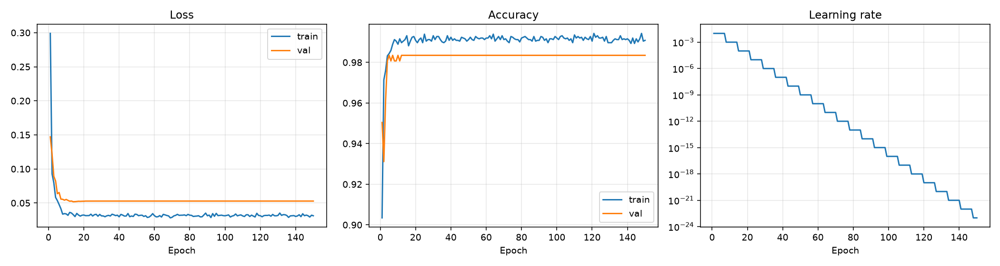
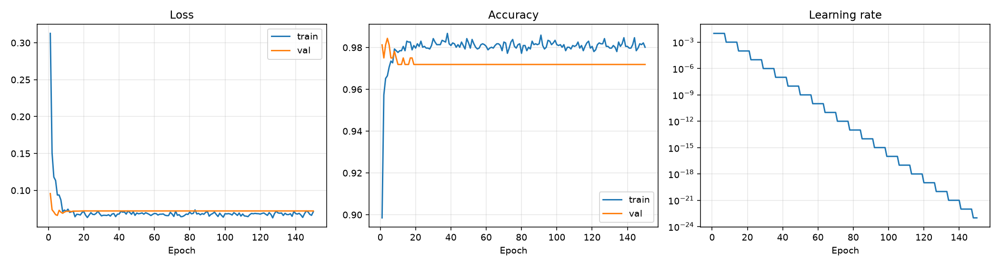
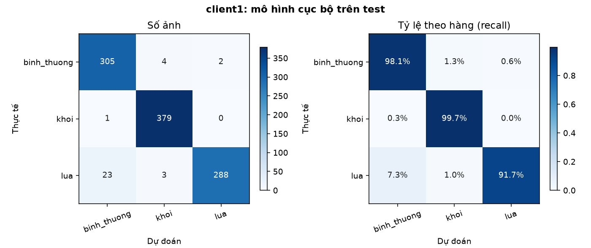
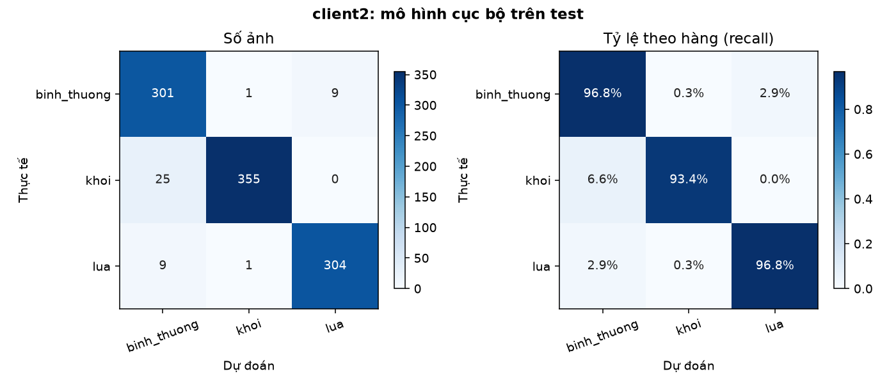
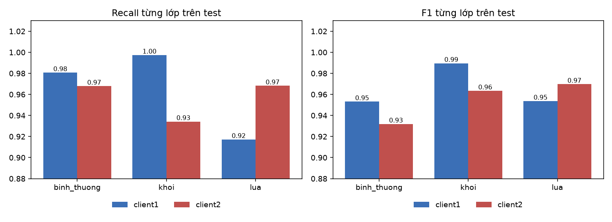

# Báo cáo huấn luyện mô hình cục bộ và kiểm tra trên tập test

## 1. Mục tiêu và phạm vi

Báo cáo trình bày kết quả huấn luyện cục bộ của hai client (client1, client2) cho bài toán phân loại ảnh ba lớp: bình thường, khói, lửa, và kết quả kiểm tra hai mô hình này trên tập test chưa từng thấy. Đây là bước đi trước khi tổng hợp trọng số bằng FedAvg: mỗi client tự huấn luyện trên dữ liệu lệch của mình, rồi được chấm trên cùng một tập test chung để xác định mức hạn chế do phân bố không đồng nhất. Kết quả này làm mốc so sánh cho mô hình sau tổng hợp.

Phạm vi:
- Có: huấn luyện cục bộ từng client, đánh giá trên tập kiểm định (val) và tập test, phân tích lỗi.
- Có: thời gian và bộ nhớ khi chạy trong giả lập Pi 4 (chỉ giới hạn số nhân và RAM, xem mục 3).
- Chưa có: kết quả FedAvg (xem `bao_cao_fedavg.md`).

## 2. Thiết lập thí nghiệm

### 2.1 Dữ liệu

Dữ liệu và cách chia tập được mô tả đầy đủ ở `bao_cao_du_lieu.md`. Tóm tắt:

| Tập | Bình thường | Khói | Lửa | Tổng |
|---|---|---|---|---|
| client1 train | 777 | 1.529 | 314 | 2.620 |
| client1 val | 104 | 217 | 42 | 363 |
| client2 train | 777 | 382 | 1.255 | 2.414 |
| client2 val | 103 | 50 | 167 | 320 |
| test (dùng chung) | 311 | 380 | 314 | 1.005 |

Client1 nghiêng về khói (58% ảnh train), client2 nghiêng về lửa (52% ảnh train). Tập test cân bằng hơn (31% bình thường, 38% khói, 31% lửa) và chỉ dùng để chấm điểm sau khi huấn luyện, không tham gia chọn mô hình.

### 2.2 Mô hình

| Thành phần | Giá trị |
|---|---|
| Kiến trúc | SqueezeNet 1.1, trọng số ImageNet (torchvision, IMAGENET1K_V1) |
| Phần đóng băng | Toàn bộ thân mạng, 722.496 tham số |
| Phần được huấn luyện | Lớp phân loại cuối (Dropout, tích chập 1×1 từ 512 kênh sang 3 lớp, ReLU, gộp trung bình), **1.539 tham số** |
| Ảnh vào | 128 × 128, kéo giãn về vuông |
| Tổng tham số | 724.035 |

Thiết kế này theo bài báo Priv-FedTL (Osmani và cộng sự, Computer Networks 286, 2026): chỉ fine-tune lớp cuối, thân mạng đóng băng. Với 2 lớp phân loại bài báo có 1.026 tham số huấn luyện; với 3 lớp của đề án là 1.539.

Vì thân mạng đóng băng và không dùng tăng cường dữ liệu, đặc trưng của mỗi ảnh (512 × 7 × 7) không đổi giữa các epoch. Đặc trưng được trích một lần, lưu ở dạng float16, mỗi epoch chỉ chạy phần phân loại. Cách làm này cho kết quả tương đương chạy lại toàn mạng mỗi epoch.

### 2.3 Siêu tham số huấn luyện

| Tham số | Giá trị | Nguồn |
|---|---|---|
| Trình tối ưu | SGD, không momentum, không weight decay | Bài báo |
| Tốc độ học | 0,01 | Bài báo |
| Điều chỉnh tốc độ học | StepLR: giảm 10 lần sau mỗi 7 epoch | Bài báo |
| Hàm mất mát | Cross-entropy | Bài báo |
| Seed | 42 | Bài báo |
| Kích thước lô | 64 | Đề án |
| Số epoch | 150, huấn luyện đủ, không dừng sớm | Đề án |
| Mô hình cuối | Trọng số của epoch cuối cùng, không chọn theo val | Đề án (theo cách làm của bài báo) |

Hai client dùng cùng cấu hình và cùng điểm khởi tạo của lớp phân loại; khác nhau chỉ ở dữ liệu cục bộ.

Giá trị val loss thấp nhất và epoch đạt được vẫn được ghi lại để tham khảo, nhưng không dùng để chọn mô hình hay dừng huấn luyện.

### 2.4 Quy trình

1. Trích đặc trưng từ thân đóng băng cho train, val của từng client và test dùng chung.
2. Mỗi client huấn luyện độc lập đủ 150 epoch, lấy trọng số epoch cuối.
3. Chấm trọng số đó trên tập test một lần.

## 3. Kết quả huấn luyện

| | client1 | client2 |
|---|---|---|
| Số epoch | 150 | 150 |
| Thời gian huấn luyện (150 epoch) | 248,9 giây | 230,1 giây |
| Thời gian mỗi epoch | 1,64 giây | 1,52 giây |
| Epoch có val loss thấp nhất (chỉ để tham khảo) | 14 (0,0518) | 5 (0,0661) |
| Val loss ở epoch cuối (mô hình được dùng) | 0,0528 | 0,0721 |
| Accuracy train / val ở epoch cuối | 99,43% / 98,35% | 98,55% / 97,19% |

Mỗi lần huấn luyện chạy trong giả lập Pi 4 bắt buộc, tự áp trong chính script (Windows Job Object: 1,6 nhân, trần bộ nhớ commit 4 GB). Bằng chứng ghi lại khi chạy (`outputs/device_runs/client*_train_<giờ>/`):

| | client1 | client2 |
|---|---|---|
| Thời gian thực cả tiến trình (gồm nạp đặc trưng, đánh giá) | 254 giây | 237 giây |
| Thời gian CPU | 274 giây | 254 giây |
| Số nhân dùng trung bình | 1,08 | 1,07 |
| RAM vật lý đỉnh (working set) | 468 MiB | 456 MiB |
| Bộ nhớ cam kết đỉnh (commit, giới hạn 4.096 MiB) | 856 MiB | 845 MiB |

**Phạm vi của giả lập:** chỉ giới hạn số nhân và RAM, không làm CPU chậm như Cortex-A72 1,5 GHz nên thời gian vẫn nhanh hơn thiết bị thật; chưa có hệ số quy đổi. Việc huấn luyện chỉ dùng khoảng 1,1 trong 1,6 nhân được cấp (đặc trưng đã trích sẵn, mô hình nhỏ), nên trung bình chưa chạm trần nhân (trần có thể vẫn chặn ở từng khoảnh khắc ngắn).

Diễn biến:
- **Client1:** val loss giảm từ 0,147 (epoch 1) xuống 0,056 (epoch 7), đạt thấp nhất 0,0518 ở epoch 14, rồi gần như đứng yên. Train accuracy tăng từ 90,3% lên khoảng 99%.
- **Client2:** val loss giảm từ 0,096 (epoch 1) xuống 0,066 (epoch 5), sau đó tăng nhẹ lên 0,072 rồi đứng yên. Train accuracy tăng từ 89,8% lên khoảng 98%.
- **Từ epoch 30 trở đi mô hình không còn học.** StepLR giảm tốc độ học 10 lần sau mỗi 7 epoch: còn 1e-6 ở epoch 29 và 1e-23 ở epoch 150. Val loss trong 120 epoch cuối gần như hằng số (client1 0,0528 trong cả khoảng; client2 0,0721). Train loss chỉ dao động quanh 0,03 (client1) và 0,065 (client2) do Dropout và thứ tự lô ngẫu nhiên, không có xu hướng giảm. Vì vậy 150 epoch thực chất cho kết quả tương đương khoảng 30 epoch.
- Không thấy dấu hiệu quá khớp rõ rệt: val loss không tăng trở lại nhiều sau khi đạt đáy; chỉ client2 tăng nhẹ từ 0,066 lên 0,072.



*Hình 1. Loss, accuracy và tốc độ học của client1 qua 150 epoch. Val loss đứng yên từ khoảng epoch 15 vì tốc độ học (phải) giảm quá nhanh.*



*Hình 2. Loss, accuracy và tốc độ học của client2 qua 150 epoch.*

## 4. Kết quả trên val và test

### 4.1 Tổng hợp

| Chỉ số | client1 | client2 |
|---|---|---|
| Accuracy train | 99,43% | 98,55% |
| Accuracy val | 98,35% | 97,19% |
| **Accuracy test** | **96,72%** | **95,52%** |
| Macro-F1 val | 0,970 | 0,976 |
| **Macro-F1 test** | **0,965** | **0,955** |
| Loss test | 0,090 | 0,104 |
| Số ảnh test sai (trên 1.005) | 33 | 45 |

Khoảng tin cậy 95% xấp xỉ của accuracy test theo chuẩn nhị thức: client1 96,7% ± 1,1 điểm, client2 95,5% ± 1,3 điểm. Ảnh test lấy từ khung hình liền nhau của cùng camera nên không độc lập hoàn toàn, khoảng thực tế rộng hơn. Hai khoảng chồng lên nhau, nên chênh lệch 1,2 điểm giữa hai client chưa đủ để kết luận client này tốt hơn client kia.

### 4.2 Kết quả từng lớp trên test

| Lớp | Chỉ số | client1 | client2 |
|---|---|---|---|
| Bình thường | Precision / Recall / F1 | 0,927 / 0,981 / 0,953 | 0,899 / 0,968 / 0,932 |
| Khói | Precision / Recall / F1 | 0,982 / **0,997** / 0,990 | 0,994 / **0,934** / 0,963 |
| Lửa | Precision / Recall / F1 | 0,993 / **0,917** / 0,954 | 0,971 / 0,968 / 0,970 |

### 4.3 Ma trận nhầm lẫn trên test (hàng: thực tế, cột: dự đoán)

client1:

| | Bình thường | Khói | Lửa |
|---|---|---|---|
| Bình thường (311) | 305 | 4 | 2 |
| Khói (380) | 1 | 379 | 0 |
| Lửa (314) | 23 | 3 | 288 |

client2:

| | Bình thường | Khói | Lửa |
|---|---|---|---|
| Bình thường (311) | 301 | 1 | 9 |
| Khói (380) | 25 | 355 | 0 |
| Lửa (314) | 9 | 1 | 304 |



*Hình 3. Ma trận nhầm lẫn của mô hình client1 trên tập test: số ảnh (trái) và tỷ lệ theo hàng (phải).*



*Hình 4. Ma trận nhầm lẫn của mô hình client2 trên tập test.*



*Hình 5. Recall và F1 từng lớp của hai mô hình cục bộ trên test (trục tung bắt đầu từ 0,88 để dễ so sánh). Hai điểm yếu đối xứng: client1 yếu lửa, client2 yếu khói.*

Danh sách ảnh bị đoán sai và xác suất từng ảnh: `outputs/model/<client>/test/errors.csv` và `predictions.csv`.

## 5. Phân tích

### 5.1 Ảnh hưởng của phân bố không đồng nhất

Mỗi mô hình nhận dạng tốt lớp mà client của mình có nhiều và kém lớp có ít:
- client1 (nhiều khói, ít lửa): recall khói 0,997 nhưng recall lửa chỉ 0,917. Trong 314 ảnh lửa có 23 ảnh bị nhầm thành bình thường, 3 ảnh thành khói.
- client2 (nhiều lửa, ít khói): recall lửa 0,968 nhưng recall khói chỉ 0,934. Trong 380 ảnh khói có 25 ảnh bị nhầm thành bình thường.

Hai điểm yếu đối xứng nhau, đúng với cách chia dữ liệu lệch 80/20. Nhóm lỗi lớn nhất của mỗi client chiếm phần lớn số lỗi: lửa nhầm thành bình thường chiếm 23/33 (70%) lỗi của client1, khói nhầm thành bình thường chiếm 25/45 (56%) lỗi của client2. Mô hình tổng hợp được kỳ vọng bù điểm yếu của nhau; điều này sẽ kiểm chứng ở bước FedAvg.

### 5.2 Khoảng cách giữa val và test

Accuracy giảm từ val sang test ở cả hai client: client1 từ 98,4% xuống 96,7% (giảm 1,6 điểm), client2 từ 97,2% xuống 95,5% (giảm 1,7 điểm). Các nguyên nhân khả dĩ:
- Val nhỏ ở lớp thiểu số (client2 chỉ có 50 ảnh khói, client1 chỉ có 42 ảnh lửa), nên chỉ số dao động.
- Val và train của cùng client chia sẻ khung cảnh camera (báo cáo dữ liệu ghi nhận hàng trăm cặp ảnh khói có hash giống hệt giữa train và val), nên val đánh giá lạc quan khả năng tổng quát.
- Test chứa nhiều khung hình khó hơn.

Kết quả trên test là con số dùng để báo cáo; val chỉ để theo dõi.

### 5.3 Phân tích lỗi

Xem mẫu ảnh sai ở lượt chạy trước (cùng cấu hình, khác ở chỗ dừng sớm): nhóm khói nhầm thành bình thường của client2 chủ yếu là các khung hình liên tiếp của cùng một camera (có trụ bê tông bên trái ảnh) với cột khói nhỏ, mờ; nhóm lửa nhầm thành bình thường của client1 gồm đám cháy nhỏ giữa rừng với khói nhiều hơn lửa, cùng một số ảnh có nhãn đáng ngờ (ví dụ ảnh người cầm vật thể màu xanh trong phòng, ảnh lính cứu hỏa kèm logo). Số lỗi của nhóm lửa nhầm thành bình thường của client1 không đổi giữa hai lượt chạy (23 ảnh) và nhóm khói của client2 chỉ giảm từ 32 xuống 25 ảnh, nên các nhận xét này phần lớn vẫn áp dụng; nên mở lại `errors.csv` của lượt mới để kiểm tra trước khi đưa vào bản chính thức. Lỗi tập trung ở một khung cảnh lặp lại nên số lỗi bị khuếch đại.

### 5.4 Tác động của việc huấn luyện đủ 150 epoch so với dừng sớm

Lượt chạy trước dùng dừng sớm (client1 dừng ở epoch 29, client2 ở epoch 20, lấy trọng số epoch có val loss thấp nhất). Lượt này huấn luyện đủ 150 epoch và lấy epoch cuối.

| | Trước (dừng sớm, epoch tốt nhất) | Sau (150 epoch, epoch cuối) |
|---|---|---|
| client1 accuracy test | 96,62% | 96,72% |
| client2 accuracy test | 94,63% | 95,52% |
| client2 ảnh sai | 54 | 45 |

Chênh lệch nhỏ (client1 khác 1 ảnh, client2 khác 9 ảnh), nằm trong khoảng tin cậy nên không nên diễn giải là cải thiện thực sự. Hai điểm đáng nhận xét:
- Với client2, epoch có val loss thấp nhất (epoch 5) cho accuracy test thấp hơn epoch cuối. Chọn mô hình theo val loss trên val nhỏ như vậy không giúp ích và có thể gây hại, cho thấy việc lấy epoch cuối theo bài báo là hợp lý.
- Việc kéo dài từ khoảng 30 lên 150 epoch không thay đổi đáng kể kết quả, vì tốc độ học đã gần bằng 0 (mục 3). Nếu muốn huấn luyện dài hơn có hiệu quả, cần đổi lịch học (ví dụ giảm tốc độ học theo val loss) chứ không chỉ tăng số epoch.

## 6. Hạn chế

1. **Một lần chạy, một seed.** Không có phương sai giữa các lần chạy; chênh lệch nhỏ giữa hai client chưa chắc có ý nghĩa thống kê.
2. **Test và val không độc lập hoàn toàn với train.** Ảnh khói là khung hình liên tiếp từ vài camera cố định; khung cảnh trùng lặp giữa các tập làm các chỉ số lạc quan hơn khả năng tổng quát với camera và địa điểm mới.
3. **Nhiễu nhãn** trong lớp lửa, quan sát được khi xem mẫu ảnh sai (xem mục 5.3).
4. **Nguồn ảnh khói đơn lẻ và ảnh khói bị kéo giãn** khi đổi về 128 × 128; mô hình có thể học đặc trưng nguồn thay vì khói.
5. **Val nhỏ** ở lớp thiểu số (50 ảnh khói ở client2, 42 ảnh lửa ở client1).
6. **Lịch học StepLR** làm tốc độ học gần bằng 0 sau khoảng 30 epoch (1e-23 ở epoch 150), nên 150 epoch không đồng nghĩa với huấn luyện dài hiệu quả; val loss không đổi trong 120 epoch cuối.
7. **Giả lập Pi 4 chỉ giới hạn số nhân và RAM.** Thời gian ở mục 3 chưa quy đổi và vẫn nhanh hơn thiết bị thật. Trần RAM là trần bộ nhớ commit của Windows.
8. Con số accuracy không so sánh trực tiếp với bài báo, vì bài báo dùng bộ dữ liệu khác (ảnh y tế và CIFAR-10).

## 7. Kết luận và bước tiếp theo

- Huấn luyện chỉ 1.539 tham số của lớp cuối trên đặc trưng đóng băng đạt accuracy test 96,7% (client1) và 95,5% (client2). Thời gian khoảng 4 phút mỗi client cho 150 epoch (trong giả lập Pi 4, chưa quy đổi sang thiết bị thật), nhưng thực chất mô hình hội tụ trong khoảng 30 epoch đầu.
- Mỗi mô hình cục bộ yếu ở lớp mà client của mình thiếu dữ liệu: client1 sót lửa (recall 0,917), client2 sót khói (recall 0,934). Đây chính là hạn chế của học cục bộ trên dữ liệu không đồng nhất mà học liên kết cần khắc phục.
- Kết quả không đổi đáng kể so với lượt chạy có dừng sớm, nên việc dùng dừng sớm hay không ít ảnh hưởng đến kết luận.
- Hai mô hình này là điểm xuất phát (vòng 0) của so sánh lock/không lock; FedAvg giữa hai client nằm ở `bao_cao_fedavg.md`.

## Phụ lục: cách chạy lại

Chạy từ thư mục gốc dự án:

```
python src/model/client1/extract_features.py
python src/model/client2/extract_features.py
python src/model/client1/train.py
python src/model/client2/train.py
python src/model/client1/evaluate_test.py
python src/model/client2/evaluate_test.py
python src/model/compare_local.py
```

Mọi tham số (số epoch, tốc độ học, chế độ finetune...) chỉnh trong `src/model/config.yaml`, các lệnh trên không cần thêm tham số. Các script chạy trên thiết bị (trừ `compare_local.py`) tự áp giới hạn Pi 4 khi khởi động và ghi bằng chứng vào `outputs/device_runs/<bước>_<giờ>/`. Kết quả ở `outputs/model/<client>/run/` (huấn luyện) và `outputs/model/<client>/test/` (kiểm tra test).
