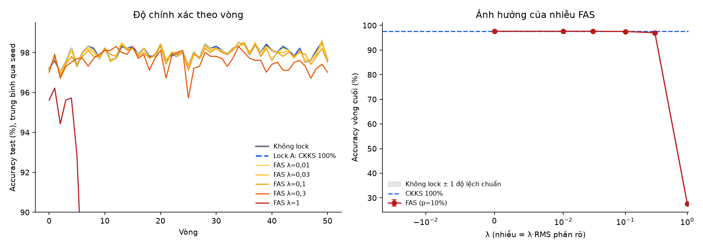

# Báo cáo tổng hợp: so sánh bảo vệ cập nhật FL (không lock, CKKS 100%, FAS) giữa 2 client và trạm gốc

Sinh tự động lúc 2026-10-31 01:20:05 bằng `src/secure_fl/experiments/make_report.py`. **Mọi con số trong báo cáo đọc trực tiếp từ các file kết quả trong `outputs/`; không có số nào được gõ tay hay ước lượng.** Dấu thập phân là dấu chấm. **Backend mã hóa của lượt chạy chính là `emulated` (mô phỏng): nó KHÔNG mã hóa thật, chỉ mô hình hóa sai số CKKS và đệm gói đúng cỡ ciphertext đã đo ở lượt OpenFHE thật cũ. Vì vậy độ chính xác và số byte hợp lệ trong giới hạn đó; thời gian mã hóa/giải mã và tính đúng của mã hóa KHÔNG đến từ OpenFHE trong báo cáo này.**

| Mục | Giá trị |
|---|---|
| Lượt chạy chính | `outputs/secure_fl/tcp/classifier/` (2026-10-31 00:24:11), lệnh `src/secure_fl/experiments/run_fl_tcp.py --seed 42` |
| Backend mã hóa | `emulated` (mô phỏng, **không phải OpenFHE thật**); BS và 2 client là 3 tiến trình TCP trên một máy Windows, không có UAV |
| Giả lập thiết bị | mỗi client tự giới hạn 1.6 nhân và 4 GB RAM (`raspberry_pi_4b`) bằng Job Object của Windows; BS không giới hạn |
| Seed | 42 (một seed duy nhất) |
| Mã nguồn | commit `823282bb75`, **có thay đổi chưa commit: có** |
| Python | 3.12.10 |

## 0. Tóm tắt

- **CKKS 100% (backend mô phỏng) không làm hại việc học.** Accuracy vòng cuối của CKKS 100% là 97.61%, không lock là 97.61%; mô hình cuối dự đoán khác không lock ở 0 ảnh; accuracy khác nhau ở 2/51 vòng. Vì backend chỉ mô hình hóa sai số CKKS (σ = 1.1e-07), đây là kết quả về ảnh hưởng của sai số đó tới việc học, không phải của OpenFHE thật.
- **Sai số tổng:** sai khác lớn nhất giữa tổng sau giải mã và tổng đúng qua 51 vòng là 4.8e-07 ở CKKS 100% (so với 1.3e-08 ở không lock, chỉ do float32); hai client giữ mô hình giống hệt nhau (‖g_client1 − g_client2‖∞ = 0.0e+00). **Mục này không chứng minh mã hóa thật đúng:** tính đúng của mã hóa đa khóa chỉ được kiểm ở `test_openfhe` trong container (xem mục 4.1).
- **FAS: nhiễu càng lớn càng hại.** Các mức λ qua cổng độ chính xác (không kém không lock quá 0.5 điểm): 0.01, 0.03, 0.1. Rớt cổng: λ=0.3, λ=1. Ở λ=1 accuracy vòng cuối chỉ còn 27.66%.
- **Chi phí byte** (mỗi client mỗi vòng, đo thật trên dây): không lock 6,220 B; CKKS 100% 198,589 B (32.3×); FAS 204,164 B (33.2×). Chênh lệch giữa CKKS 100% và FAS là 5,575 B (2.8%).
- **Qua cổng độ chính xác:** Lock A: CKKS 100%, FAS λ=0,01, FAS λ=0,03, FAS λ=0,1. Ít byte nhất: **Lock A: CKKS 100%**. Đây chỉ là xếp hạng SƠ BỘ theo độ chính xác và byte, chênh lệch nhỏ (xem mục 5); **chưa phải kết luận chọn phương pháp tốt nhất**, vì báo cáo không đo mức bảo mật và chưa đo kênh (chưa có UAV).
- **Độ lặp lại:** hai lượt `none` cùng cấu hình khác nhau ở 0/51 vòng về accuracy (lệch lớn nhất 0.00 điểm) và 0 ảnh dự đoán ở mô hình cuối.
- **Giả lập Pi 4:** cấu hình 1.6 nhân và 4 GB RAM cho mỗi client; có bằng chứng giới hạn ghi lại khi chạy cho 10/10 arm (mục 2.6). Giả lập chỉ giới hạn số nhân và RAM, **không làm CPU chậm như Cortex-A72**, nên thời gian đo vẫn nhanh hơn Pi thật.

**Báo cáo này KHÔNG chứng minh:** (1) kết quả thống kê chắc chắn, vì chỉ có một seed nên không có khoảng tin cậy; (2) bảo mật theo nghĩa mật mã của FAS: phần xáo vị trí và nhiễu là cơ chế heuristic, không có bảo đảm DP; (3) hiệu năng trên kênh vô tuyến, vì chưa đo UAV; (4) kết luận cho mô hình lớn hơn lớp cuối 1.539 tham số; (5) mức bảo mật của từng phương án: báo cáo chỉ đo độ chính xác, chi phí truyền thông và thời gian.

## 1. Mục tiêu và phạm vi

Hai client (client1, client2) huấn luyện mô hình nhận dạng ảnh ba lớp (bình thường, khói, lửa) và gửi cập nhật lên trạm gốc (BS) để gộp bằng FedAvg. Báo cáo so sánh ba cách gửi cập nhật và tìm phương pháp mã hóa tốt nhất theo các chỉ số cụ thể:

| Phương án | Bảo vệ | BS thấy |
|---|---|---|
| `none` (không lock) | gửi trọng số rõ | trọng số từng client |
| `ckks_full` (lock A) | mã hóa 100% bằng CKKS đa khóa 2-of-2 (ở lượt chính: mô phỏng sai số CKKS) | chỉ ciphertext; sau khi ghép phần giải mã biết tổng |
| `fas` (lock B) | 10% tham số đầu mã hóa CKKS; phần còn lại cộng nhiễu N(0,(λ·RMS)²) rồi xáo vị trí bằng hoán vị π_t | phần mã hóa không đọc được; phần rõ đã nhiễu và xáo |
| `fasbs` (mốc yếu) | như `fas` nhưng BS cũng giữ khóa xáo K (giống FAS gốc của Korkmaz và Rao) | phần rõ đã nhiễu, đọc được vị trí |

Phạm vi: chỉ giao thức client ↔ BS (BS và hai client là ba tiến trình TCP trên một máy). Kênh vô tuyến và UAV có mã và test (`src/uav_channel/`) nhưng **chưa được dùng để đo**.

## 2. Thiết lập thí nghiệm

### 2.1 Mô hình và dữ liệu

| Mục | Giá trị | Nguồn |
|---|---|---|
| Mô hình | SqueezeNet 1.1, thân đóng băng (ImageNet), chỉ huấn luyện lớp phân loại cuối; 1,539 tham số | `src/model/config.yaml` (`trainable: classifier`), kết quả |
| Ảnh vào | 128×128, `squash` | `src/model/config.yaml` |
| Số ảnh train | client1 2620, client2 2414 | `bs_log.json` (tin HELLO của client) |
| Cơ cấu lớp của hai client | lệch có chủ đích (client1 nghiêng về khói, client2 nghiêng về lửa) | `report/bao_cao_gia_lap_thiet_bi.md`, không đo lại trong lượt này |
| Tập test chung | 1005 ảnh (suy ra từ số ảnh sai và accuracy của `none`) | kết quả |
| Tối ưu cục bộ | SGD, lr 0.01, momentum 0.0, batch 64 | `src/model/config.yaml` |
| Số vòng FL, epoch cục bộ mỗi vòng | 50 vòng, 1 epoch | `src/model/config.yaml` (mục `fl`) |

### 2.2 Luồng một lượt chạy

1. Mỗi client đã huấn luyện cục bộ 150 epoch riêng, cho ra `weights.npy` (`outputs/model/client*/run/`). Hai file này dùng chung cho mọi phương án.
2. **Vòng 0:** mỗi client nhân trọng số đó với n_k/n, bảo vệ rồi gửi BS; BS cộng; hai client giải mã ra mô hình toàn cục ban đầu (= "trung bình 1 lần" của hai mô hình cục bộ, nhưng qua bảo vệ).
3. **Vòng 1…50:** mỗi client huấn luyện 1 epoch từ mô hình toàn cục, nhân trọng số mới với n_k/n, bảo vệ, gửi BS; BS cộng, (nếu có mã hóa) gửi tổng ciphertext cho hai client, mỗi client tạo phần giải mã, BS ghép, gửi tổng về; client giải mã/giải xáo và cập nhật mô hình. Client1 đánh giá trên tập test mỗi vòng.
4. Mọi phương án (kể cả `none` và `none_rerun`) đi qua đúng quy trình này, cùng seed, cùng dữ liệu, cùng điểm xuất phát. `none_rerun` là lần chạy lại `none` để đo nhiễu nền.

Cái được bảo vệ là **trọng số mô hình** (không phải cập nhật Δ). Tổng của hai vector đã nhân n_k/n chính là FedAvg nên BS chỉ cần cộng ("cộng mù").

### 2.3 Các phương án chạy (arm)

Có 10 arm: `none`, `none_rerun`, `ckks_full`, `fas_lam0`, `fas_lam0.01`, `fas_lam0.03`, `fas_lam0.1`, `fas_lam0.3`, `fas_lam1`, `fasbs_lam0.1`. Lưới λ của FAS (nhiễu = λ × RMS của phần rõ) là **giả định của đề tài**, không lấy từ bài báo FAS (bài báo không nêu mức nhiễu): `fas_lams = [0.0, 0.01, 0.03, 0.1, 0.3, 1.0]`; mốc `fasbs` dùng λ = [0.1]. Tỷ lệ mã hóa p = 0.1. Thứ tự ưu tiên mã hóa: bias rồi trọng số theo chỉ số tăng (giả định cố định). Nhiễu và khóa xáo K sinh từ seed để lặp lại được (`noise_entropy: seeded`).

### 2.4 Tham số mã hóa

| Tham số CKKS | Giá trị |
|---|---|
| Kích thước vành N (`ring_dim`) | 8192 |
| Số ô (slot) mỗi ciphertext | 4096 (= N/2) |
| Scale (`scale_bits`), modulus đầu (`first_mod_bits`) | 50 bit, 60 bit |
| Độ sâu nhân | 0 (chỉ cộng); mức an toàn `HEStd_128_classic` (`mkckks.py`) |
| Khóa (thiết kế, chỉ có ở OpenFHE thật) | đa khóa 2-of-2: client1 `KeyGen`, client2 `MultipartyKeyGen`; khóa bí mật không rời tiến trình; BS không có khóa bí mật |
| Backend của lượt chạy chính | `emulated`: không có khóa, không mã hóa; cộng số thực rồi thêm sai số ngẫu nhiên σ = 1.1e-07 (`he.error_sigma`) mỗi lần mã hóa/giải mã |
| Kích thước ciphertext / phần giải mã dùng để đệm gói | 132,121 B / 66,388 B (`he.ct_bytes`, `he.share_bytes`, đo ở lượt OpenFHE thật 30/10/2026) |

Mô hình có 1,539 tham số, vừa trong 1 ciphertext (4096 ô). FAS mã hóa 154 giá trị đầu: vẫn cần đúng 1 ciphertext (số ciphertext trong lượt chạy: `ckks_full` = 1, `fas` = 1; với backend mô phỏng đây là số gói được đệm, không phải ciphertext thật).

### 2.5 Mô hình đe dọa (giả định thiết kế)

BS tò mò nhưng trung thực (thụ động); BS và UAV không giữ khóa HE, BS không giữ K (trừ mốc `fasbs`). BS biết tổng sau khi ghép phần giải mã (giới hạn đã chấp nhận).


### 2.6 Môi trường chạy và giả lập thiết bị Pi 4

BS và hai client là ba tiến trình Python trên cùng một máy Windows, nối với nhau bằng TCP trên localhost (`127.0.0.1`). BS chỉ nhận trọng số đã bảo vệ và cộng, không có mô hình, khóa hay K (trừ arm `fasbs`); mỗi client chỉ đọc dữ liệu của mình (client1 thêm tập test). Không có UAV, không bóp tốc độ, không có độ trễ mạng.

**Giả lập Pi 4 bắt buộc, tự áp trong chính script của client** (`devicelimit.enforce`): Windows Job Object giới hạn cứng CPU ở 1.6 nhân (= 1.6 / số nhân logic của máy) và trần bộ nhớ commit 4 GB cho tiến trình. Giới hạn được đọc lại từ Windows (`QueryInformationJobObject`) rồi ghi vào file bằng chứng. **Phạm vi của giả lập:** chỉ giới hạn số nhân và RAM; **không làm chậm CPU như Cortex-A72 1,5 GHz**, nên mọi thời gian trong báo cáo vẫn nhanh hơn thiết bị thật và chưa có hệ số quy đổi. BS không bị giới hạn. Trần RAM trên Windows là trần commit, không phải bộ nhớ vật lý.

Bằng chứng giới hạn của hai client trong từng arm (`device_limits_client1.json`, `device_limits_client2.json` trong thư mục arm; working set = RAM vật lý đỉnh, commit = bộ nhớ cam kết đỉnh):

| Phương án | Giới hạn đọc lại: nhân / RAM (MiB) | CPU hard cap | Working set đỉnh client1 / client2 (MiB) | Commit đỉnh client1 / client2 (MiB) | Số nhân dùng TB client1 / client2 | Thời gian thực client1 (s) |
|---|---|---|---|---|---|---|
| Không lock | 1.60 / 4096 | có | 495 / 409 | 1015 / 748 | 1.18 / 1.03 | 105 |
| Không lock (chạy lại) | 1.60 / 4096 | có | 495 / 407 | 1015 / 747 | 1.17 / 1.03 | 102 |
| Lock A: CKKS 100% | 1.60 / 4096 | có | 495 / 404 | 1015 / 749 | 1.18 / 1.02 | 107 |
| FAS λ=0 | 1.60 / 4096 | có | 542 / 407 | 1016 / 749 | 1.19 / 1.05 | 94 |
| FAS λ=0,01 | 1.60 / 4096 | có | 663 / 410 | 1026 / 749 | 1.23 / 1.10 | 72 |
| FAS λ=0,03 | 1.60 / 4096 | có | 496 / 410 | 1026 / 749 | 1.21 / 1.05 | 76 |
| FAS λ=0,1 | 1.60 / 4096 | có | 663 / 408 | 1015 / 748 | 1.20 / 1.04 | 71 |
| FAS λ=0,3 | 1.60 / 4096 | có | 511 / 403 | 1015 / 748 | 1.22 / 1.07 | 75 |
| FAS λ=1 | 1.60 / 4096 | có | 495 / 408 | 1015 / 748 | 1.21 / 1.07 | 74 |
| FAS gốc (BS giữ K) λ=0,1 | 1.60 / 4096 | có | 496 / 410 | 1016 / 749 | 1.19 / 1.04 | 74 |

Các bước chuẩn bị mô hình (trích đặc trưng, huấn luyện cục bộ 150 epoch, đánh giá test, FedAvg tham chiếu, nhiều seed) cũng tự áp cùng giới hạn; bằng chứng ở `outputs/device_runs/<bước>_<giờ>/` (`device_limits.json`, `run.json`, `output.log`). Bản MỚI NHẤT của mỗi bước:

| Bước | Lệnh | Thời gian thực (s) | Thời gian CPU (s) | Số nhân TB | Working set đỉnh (MiB) | Commit đỉnh (MiB) | Giới hạn đọc lại: nhân / RAM (MiB) | Kết thúc |
|---|---|---|---|---|---|---|---|---|
| 1. Trích đặc trưng client1 (cả tập test) | `python src/model/client1/extract_features.py` | 35 | 40 | 1.13 | 855 | 1718 | 1.60 / 4096 | bình thường (2026-10-31 00:10:13) |
| 2. Trích đặc trưng client2 | `python src/model/client2/extract_features.py` | 26 | 29 | 1.11 | 1142 | 1628 | 1.60 / 4096 | bình thường (2026-10-31 00:11:01) |
| 3. Huấn luyện cục bộ client1 (150 epoch) | `python src/model/client1/train.py` | 254 | 274 | 1.08 | 468 | 856 | 1.60 / 4096 | bình thường (2026-10-31 00:15:44) |
| 4. Huấn luyện cục bộ client2 (150 epoch) | `python src/model/client2/train.py` | 237 | 254 | 1.07 | 456 | 845 | 1.60 / 4096 | bình thường (2026-10-31 00:19:50) |
| 5. Đánh giá test client1 | `python src/model/client1/evaluate_test.py` | 7 | 6 | 0.80 | 376 | 769 | 1.60 / 4096 | bình thường (2026-10-31 00:20:05) |
| 6. Đánh giá test client2 | `python src/model/client2/evaluate_test.py` | 4 | 4 | 0.98 | 376 | 769 | 1.60 / 4096 | bình thường (2026-10-31 00:20:17) |
| 8. Đo thời gian 1 epoch huấn luyện | `python src/secure_fl/experiments/bench_train.py classifier` | 24 | 29 | 1.18 | 498 | 859 | 1.60 / 4096 | bình thường (2026-10-31 00:21:00) |
| 9. FedAvg không mã hóa tham chiếu (2 client, 1 tiến trình) | `python src/model/run_fedavg.py` | 176 | 189 | 1.07 | 649 | 1034 | 1.60 / 4096 | bình thường (2026-10-31 00:24:05) |
| 11. Nhiều seed × 2 chế độ (2 client, 1 tiến trình) | `python src/model/run_experiments.py` | 1977 | 2682 | 1.36 | 1273 | 2262 | 1.60 / 4096 | bình thường (2026-10-31 01:12:51) |

Ghi chú: bước 9 (`run_fedavg`) và 11 (`run_experiments`) chạy cả hai client lần lượt trong MỘT tiến trình nên dùng chung một giới hạn 1.6 nhân / 4 GB, và RAM đỉnh là của cả hai client; ở lượt chính (bước 10) mỗi client là một tiến trình riêng có giới hạn riêng.

## 3. Cách đo

- **Độ chính xác:** accuracy trên tập test của client1 sau mỗi vòng; báo cáo vòng cuối và trung bình 10 vòng cuối; số ảnh dự đoán khác `none` ở mô hình cuối; độ lệch trọng số lớn nhất so với `none` (‖w−w_none‖∞).
- **Byte:** BS đếm số byte của từng khung tin nhắn (4 byte độ dài + thân msgpack) khi gửi/nhận, ghi vào `bs_log.json`. Byte lên mỗi client mỗi vòng = UPLOAD + PARTIAL_DEC; byte xuống = CSUM + AGGREGATE; trung bình qua mọi vòng (0…50) và hai client. Chưa tính tiêu đề TCP/IP.
- **Thời gian:** thời gian từng pha đo bằng đồng hồ trong tiến trình (huấn luyện, bảo vệ, giải mã từng phần, BS cộng, BS ghép, vòng đầu-cuối) trên localhost, không có độ trễ mạng. Client chạy trong giả lập Pi 4 (chỉ số nhân và RAM). Với backend mô phỏng, thời gian bảo vệ/giải mã/ghép của phần HE là thời gian của mô phỏng, không phải của OpenFHE.
- **Chọn phương án:** cổng độ chính xác = accuracy không kém `none` quá 0.5 điểm (một seed nên dùng trung bình 10 vòng cuối, không có khoảng tin cậy); qua cổng thì xếp theo byte, kết quả chỉ là xếp hạng sơ bộ. Ứng viên không gồm `none`, `none_rerun`, `fas_lam0` (chỉ kiểm tra đúng), `fasbs` (mốc).

## 4. Kết quả (lượt chạy chính: backend mô phỏng, client trong giả lập Pi 4)

### 4.1 Kiểm thử

Kết quả `tests/run_all.py` mới nhất (`outputs/secure_fl/tests/20261031_011448/`, thời điểm: 2026-10-31 01:16:12). Dòng `windows` chạy trực tiếp trên máy (không có OpenFHE); dòng `docker` chạy trong container có OpenFHE thật:

| Test | Nơi chạy | Kết quả | Bài đạt | Bài lỗi | Bài bỏ qua | Giây |
|---|---|---|---|---|---|---|
| tests/secure_fl/test_security.py | windows | ĐẠT | 12 | 0 | 1 | 0 |
| tests/secure_fl/test_protocol.py | windows | ĐẠT | 4 | 0 | 0 | 6 |
| tests/secure_fl/test_device_profile.py | windows | ĐẠT | 4 | 0 | 0 | 0 |
| tests/secure_fl/test_devicelimit.py | windows | ĐẠT | 4 | 0 | 0 | 13 |
| tests/secure_fl/test_device_guard.py | windows | ĐẠT | 5 | 0 | 0 | 1 |
| tests/uav_channel/test_channel.py | windows | ĐẠT | 1 | 0 | 0 | 0 |
| tests/uav_channel/test_uav_relay.py | windows | ĐẠT | 1 | 0 | 0 | 56 |
| tests/secure_fl/test_openfhe.py | docker | ĐẠT | 2 | 0 | 0 | 4 |
| tests/secure_fl/test_security.py | docker | ĐẠT | 12 | 0 | 0 | 2 |

- `test_openfhe` (mã hóa thật, ba vai trò qua socket, trong container): OpenFHE đa khóa qua mạng: sai số 4.0e-07; ciphertext 132,121 B, phần giải mã 66,388 B
- `test_openfhe` (mã hóa thật, ba vai trò qua socket, trong container): một phần giải mã đơn lẻ không đủ để giải mã

**Phạm vi:** các test `docker` kiểm tra mã hóa đa khóa thật trên mã nguồn hiện tại, nhưng **lượt chạy FL 50 vòng ở mục 4.2 trở đi dùng backend mô phỏng**, không phải OpenFHE; lượt FL 50 vòng với OpenFHE thật đã chạy trước đây (đối chiếu ở cuối mục 4) và chưa chạy lại sau khi thêm giả lập Pi 4.

### 4.2 Ảnh hưởng tới độ chính xác của FL

| Phương án | Acc vòng 0 (%) | Acc vòng cuối (%) | Acc TB 10 vòng cuối (%) | Macro-F1 | Recall bình thường | Recall khói | Recall lửa | Ảnh sai | Ảnh khác none | Chênh so với none (điểm) | Đạt cổng 1 | ‖w−w_none‖∞ | Vòng đạt 97,5% | Dao động 5 vòng cuối |
|---|---|---|---|---|---|---|---|---|---|---|---|---|---|---|
| Không lock | 97.21 | 97.61 | 97.98 | 0.975 | 0.994 | 0.997 | 0.933 | 24.0 | 0.0 | — | — | 0.0e+00 | 1.0 | 0.43 |
| Không lock (chạy lại) | 97.21 | 97.61 | 97.98 | 0.975 | 0.994 | 0.997 | 0.933 | 24.0 | 0.0 | +0.00 (1 seed, TB 10 vòng cuối) | — | 0.0e+00 | 1.0 | 0.43 |
| Lock A: CKKS 100% | 97.21 | 97.61 | 97.98 | 0.975 | 0.994 | 0.997 | 0.933 | 24.0 | 0.0 | +0.00 (1 seed, TB 10 vòng cuối) | có | 1.1e-03 | 1.0 | 0.43 |
| FAS λ=0 | 97.21 | 97.61 | 97.98 | 0.975 | 0.994 | 0.997 | 0.933 | 24.0 | 0.0 | +0.00 (1 seed, TB 10 vòng cuối) | có | 1.3e-03 | 1.0 | 0.43 |
| FAS λ=0,01 | 97.21 | 97.61 | 97.93 | 0.975 | 0.994 | 0.997 | 0.933 | 24.0 | 2.0 | -0.05 (1 seed, TB 10 vòng cuối) | có | 4.8e-03 | 1.0 | 0.37 |
| FAS λ=0,03 | 97.11 | 97.61 | 97.93 | 0.975 | 0.994 | 0.997 | 0.933 | 24.0 | 2.0 | -0.05 (1 seed, TB 10 vòng cuối) | có | 1.4e-02 | 1.0 | 0.43 |
| FAS λ=0,1 | 97.11 | 97.51 | 97.85 | 0.974 | 0.994 | 0.997 | 0.930 | 25.0 | 4.0 | -0.13 (1 seed, TB 10 vòng cuối) | có | 4.9e-02 | 1.0 | 0.32 |
| FAS λ=0,3 | 97.01 | 97.01 | 97.25 | 0.969 | 0.971 | 0.992 | 0.943 | 30.0 | 21.0 | -0.73 (1 seed, TB 10 vòng cuối) | không | 2.4e-01 | 1.0 | 0.28 |
| FAS λ=1 | 95.62 | 27.66 | 38.70 | 0.241 | 0.032 | 0.263 | 0.535 | 727.0 | 740.0 | -59.28 (1 seed, TB 10 vòng cuối) | không | 1.8e+03 | nan | 8.39 |
| FAS gốc (BS giữ K) λ=0,1 | 97.11 | 97.51 | 97.85 | 0.974 | 0.994 | 0.997 | 0.930 | 25.0 | 4.0 | -0.13 (1 seed, TB 10 vòng cuối) | — | 4.9e-02 | 1.0 | 0.32 |

Mốc không lock (huấn luyện cục bộ và FedAvg tham chiếu ở bước 3-9, `outputs/model/`): mô hình cục bộ client1 96.72%, client2 95.52%; trung bình 1 lần 97.21%; FedAvg 50 vòng từ mô hình khởi tạo 98.11%. Nhánh `none` của lượt chạy này cho 97.21% ở vòng 0 ("trung bình 1 lần": trùng) và 97.61% ở vòng cuối. Hai con số vòng cuối không so trực tiếp được vì điểm xuất phát khác nhau. Số mốc lấy từ file `outputs/model/fedavg_50/metrics.json` hiện tại.

Accuracy trên tập test (%) tại một số vòng:

| Phương án | vòng 0 | vòng 1 | vòng 2 | vòng 5 | vòng 10 | vòng 20 | vòng 30 | vòng 40 | vòng 50 |
|---|---|---|---|---|---|---|---|---|---|
| Không lock | 97.21 | 97.61 | 97.01 | 97.31 | 98.21 | 98.41 | 98.31 | 98.11 | 97.61 |
| Không lock (chạy lại) | 97.21 | 97.61 | 97.01 | 97.31 | 98.21 | 98.41 | 98.31 | 98.11 | 97.61 |
| Lock A: CKKS 100% | 97.21 | 97.61 | 97.01 | 97.31 | 98.21 | 98.41 | 98.31 | 98.11 | 97.61 |
| FAS λ=0 | 97.21 | 97.61 | 97.01 | 97.31 | 98.21 | 98.41 | 98.31 | 98.11 | 97.61 |
| FAS λ=0,01 | 97.21 | 97.71 | 97.01 | 97.31 | 98.21 | 98.41 | 98.21 | 98.11 | 97.61 |
| FAS λ=0,03 | 97.11 | 97.81 | 96.92 | 97.31 | 98.21 | 98.41 | 98.21 | 98.11 | 97.61 |
| FAS λ=0,1 | 97.11 | 97.81 | 96.82 | 97.41 | 98.21 | 98.31 | 98.21 | 97.61 | 97.51 |
| FAS λ=0,3 | 97.01 | 97.91 | 96.72 | 97.71 | 98.11 | 98.11 | 97.81 | 97.41 | 97.01 |
| FAS λ=1 | 95.62 | 96.22 | 94.43 | 92.84 | 84.68 | 64.78 | 47.16 | 35.62 | 27.66 |
| FAS gốc (BS giữ K) λ=0,1 | 97.11 | 97.81 | 96.82 | 97.41 | 98.21 | 98.31 | 98.21 | 97.61 | 97.51 |

Chi tiết theo vòng so với `none` (số vòng mà accuracy khác nhau, lệch lớn nhất, độ lệch trọng số):

| Phương án | Số vòng accuracy khác `none` | Lệch accuracy lớn nhất (điểm) | ‖w−w_none‖∞ sau vòng 1 | ‖w−w_none‖∞ vòng cuối |
|---|---|---|---|---|
| Không lock (chạy lại) | 0/51 | 0.00 | 0.0e+00 | 0.0e+00 |
| Lock A: CKKS 100% | 2/51 | 0.10 | 5.9e-07 | 1.1e-03 |
| FAS λ=0 | 0/51 | 0.00 | 4.6e-07 | 1.3e-03 |
| FAS λ=0,01 | 13/51 | 0.20 | 7.0e-04 | 4.8e-03 |
| FAS λ=0,03 | 25/51 | 0.30 | 2.0e-03 | 1.4e-02 |
| FAS λ=0,1 | 43/51 | 0.50 | 7.1e-03 | 4.9e-02 |
| FAS λ=0,3 | 50/51 | 1.59 | 2.1e-02 | 2.4e-01 |
| FAS λ=1 | 51/51 | 75.92 | 7.7e-02 | 1.8e+03 |
| FAS gốc (BS giữ K) λ=0,1 | 43/51 | 0.50 | 7.1e-03 | 4.9e-02 |



### 4.3 Tính đúng của mã hóa và đồng bộ hai client

Sai khác giữa tổng mà hai client nhận được sau giải mã và tổng đúng tính từ trọng số thật của hai client (giá trị tuyệt đối lớn nhất trên các phần tử, mỗi vòng), độ lệch giữa mô hình của hai client sau vòng cuối, và độ lệch chuẩn nhiễu thực tế FAS đã cộng vào phần rõ (trung bình các vòng, theo tiến trình client1).

| Phương án | Sai khác tổng, vòng 0 | Sai khác tổng, trung bình các vòng | Sai khác tổng, lớn nhất | ‖g_client1 − g_client2‖∞ | Độ lệch chuẩn nhiễu đã cộng |
|---|---|---|---|---|---|
| Không lock | 6.8e-09 | 7.4e-09 | 1.3e-08 | 0.0e+00 | 0.0e+00 |
| Không lock (chạy lại) | 6.8e-09 | 7.4e-09 | 1.3e-08 | 0.0e+00 | 0.0e+00 |
| Lock A: CKKS 100% | 3.7e-07 | 3.9e-07 | 4.8e-07 | 0.0e+00 | 0.0e+00 |
| FAS λ=0 | 3.2e-07 | 3.1e-07 | 3.9e-07 | 0.0e+00 | 0.0e+00 |
| FAS λ=0,01 | 4.6e-04 | 6.3e-04 | 8.4e-04 | 0.0e+00 | 1.3e-04 |
| FAS λ=0,03 | 1.4e-03 | 1.9e-03 | 2.5e-03 | 0.0e+00 | 3.9e-04 |
| FAS λ=0,1 | 4.6e-03 | 6.6e-03 | 8.9e-03 | 0.0e+00 | 1.4e-03 |
| FAS λ=0,3 | 1.4e-02 | 3.0e-02 | 5.0e-02 | 0.0e+00 | 6.1e-03 |
| FAS λ=1 | 4.6e-02 | 1.1e+02 | 1.0e+03 | 0.0e+00 | 2.2e+01 |
| FAS gốc (BS giữ K) λ=0,1 | 4.6e-03 | 6.6e-03 | 8.9e-03 | 0.0e+00 | 1.4e-03 |

Cách đọc: với `none`, `ckks_full` và `fas_lam0` (không nhiễu cố ý) sai khác tổng là sai số số học (float32 ở `none`; thêm sai số CKKS ở hai phương án còn lại). Với FAS λ > 0 sai khác tổng chủ yếu là nhiễu cố ý đã cộng. Cột ‖g_client1 − g_client2‖∞ bằng 0 nghĩa là hai client giữ mô hình giống hệt nhau.

### 4.4 Chi phí truyền thông và thời gian

| Phương án | Ciphertext | UPLOAD + PARTIAL_DEC (B/client/vòng) | Phình so với rõ | Chiều xuống (B/client/vòng) | Bảo vệ tại client (ms) | BS cộng (ms) | BS ghép (ms) | Giải mã từng phần (ms) | Vòng đầu-cuối trên localhost (s) |
|---|---|---|---|---|---|---|---|---|---|
| Không lock | 0 | 6,220 | 1.0× | 6,219 | 0.0 | 0.0 | 0.0 | 0.0 | 2.05 |
| Không lock (chạy lại) | 0 | 6,220 | 1.0× | 6,219 | 0.0 | 0.0 | 0.0 | 0.0 | 1.98 |
| Lock A: CKKS 100% | 1 | 198,589 | 32.3× | 138,370 | 0.2 | 0.0 | 0.3 | 0.0 | 2.08 |
| FAS λ=0 | 1 | 204,164 | 33.2× | 143,979 | 0.3 | 0.3 | 0.0 | 0.0 | 1.83 |
| FAS λ=0,01 | 1 | 204,164 | 33.2× | 143,979 | 0.3 | 0.0 | 0.3 | 0.0 | 1.41 |
| FAS λ=0,03 | 1 | 204,164 | 33.2× | 143,979 | 0.3 | 0.3 | 0.0 | 0.0 | 1.49 |
| FAS λ=0,1 | 1 | 204,164 | 33.2× | 143,979 | 0.3 | 0.0 | 0.0 | 0.0 | 1.39 |
| FAS λ=0,3 | 1 | 204,164 | 33.2× | 143,979 | 0.3 | 0.0 | 0.0 | 0.0 | 1.47 |
| FAS λ=1 | 1 | 204,164 | 33.2× | 143,979 | 0.3 | 0.0 | 0.0 | 0.0 | 1.44 |
| FAS gốc (BS giữ K) λ=0,1 | 1 | 204,164 | 33.2× | 143,979 | 0.3 | 0.0 | 0.0 | 0.0 | 1.44 |

Byte của từng loại tin nhắn, trung bình mỗi vòng (vòng 0…50), tính trên mỗi client (`METRICS` chỉ do client1 gửi):

| Phương án | ROUND_START | UPLOAD | CSUM | PARTIAL_DEC | AGGREGATE | METRICS |
|---|---|---|---|---|---|---|
| Không lock | 36 | 6,220 | 0 | 0 | 6,219 | 129 |
| Không lock (chạy lại) | 36 | 6,220 | 0 | 0 | 6,219 | 129 |
| Lock A: CKKS 100% | 36 | 132,158 | 132,153 | 66,431 | 6,217 | 129 |
| FAS λ=0 | 36 | 137,733 | 137,728 | 66,431 | 6,251 | 129 |
| FAS λ=0,01 | 36 | 137,733 | 137,728 | 66,431 | 6,251 | 129 |
| FAS λ=0,03 | 36 | 137,733 | 137,728 | 66,431 | 6,251 | 129 |
| FAS λ=0,1 | 36 | 137,733 | 137,728 | 66,431 | 6,251 | 129 |
| FAS λ=0,3 | 36 | 137,733 | 137,728 | 66,431 | 6,251 | 129 |
| FAS λ=1 | 36 | 137,733 | 137,728 | 66,431 | 6,251 | 129 |
| FAS gốc (BS giữ K) λ=0,1 | 36 | 137,733 | 137,728 | 66,431 | 6,251 | 129 |

Tổng hợp byte lên và xuống:

| Phương án | UPLOAD (B) | PARTIAL_DEC (B) | Tổng lên (B) | Tổng xuống (B) | Tổng lên cả lượt, mỗi client (MB) |
|---|---|---|---|---|---|
| Không lock | 6,220 | 0 | 6,220 | 6,219 | 0.32 |
| Không lock (chạy lại) | 6,220 | 0 | 6,220 | 6,219 | 0.32 |
| Lock A: CKKS 100% | 132,158 | 66,431 | 198,589 | 138,370 | 10.13 |
| FAS λ=0 | 137,733 | 66,431 | 204,164 | 143,979 | 10.41 |
| FAS λ=0,01 | 137,733 | 66,431 | 204,164 | 143,979 | 10.41 |
| FAS λ=0,03 | 137,733 | 66,431 | 204,164 | 143,979 | 10.41 |
| FAS λ=0,1 | 137,733 | 66,431 | 204,164 | 143,979 | 10.41 |
| FAS λ=0,3 | 137,733 | 66,431 | 204,164 | 143,979 | 10.41 |
| FAS λ=1 | 137,733 | 66,431 | 204,164 | 143,979 | 10.41 |
| FAS gốc (BS giữ K) λ=0,1 | 137,733 | 66,431 | 204,164 | 143,979 | 10.41 |

Ghi chú: "tổng cả lượt" = trung bình mỗi vòng × 51 vòng. Kích thước kỳ vọng theo công thức: một ciphertext gồm 2 đa thức × N × 8 byte = 131,072 B, một phần giải mã gồm 1 đa thức = 65,536 B (cộng tiêu đề); đo được UPLOAD 132,158 B và PARTIAL_DEC 66,431 B ở `ckks_full`.

Thời gian từng pha, trung bình mỗi vòng (đồng hồ trong tiến trình, 3 tiến trình trên một máy, client trong giả lập Pi 4, không có kênh). Các cột "chờ" gồm cả thời gian chờ bên chậm hơn, không phải thời gian tính toán:

| Phương án | Client: huấn luyện (s) | Client: bảo vệ (ms) | Client: giải mã từng phần (ms) | Client: hoàn tất/giải xáo (ms) | Client1: đánh giá test (s) | BS: chờ UPLOAD (s) | BS: cộng (ms) | BS: chờ PARTIAL_DEC (s) | BS: ghép (ms) | BS: vòng đầu-cuối (s) |
|---|---|---|---|---|---|---|---|---|---|---|
| Không lock | 1.86 | 0.1 | 0.0 | 0.4 | 0.16 | 1.88 | 0.0 | 0.00 | 0.0 | 2.05 |
| Không lock (chạy lại) | 1.79 | 0.0 | 0.0 | 0.3 | 0.15 | 1.82 | 0.0 | 0.00 | 0.0 | 1.98 |
| Lock A: CKKS 100% | 1.88 | 0.2 | 0.0 | 0.3 | 0.16 | 1.91 | 0.0 | 0.00 | 0.3 | 2.08 |
| FAS λ=0 | 1.67 | 0.4 | 0.0 | 0.5 | 0.13 | 1.69 | 0.3 | 0.00 | 0.0 | 1.83 |
| FAS λ=0,01 | 1.29 | 0.3 | 0.0 | 0.4 | 0.10 | 1.30 | 0.0 | 0.00 | 0.3 | 1.41 |
| FAS λ=0,03 | 1.36 | 0.3 | 0.0 | 0.4 | 0.11 | 1.38 | 0.3 | 0.00 | 0.0 | 1.49 |
| FAS λ=0,1 | 1.25 | 0.3 | 0.0 | 0.4 | 0.10 | 1.26 | 0.0 | 0.00 | 0.0 | 1.39 |
| FAS λ=0,3 | 1.34 | 0.4 | 0.0 | 0.5 | 0.11 | 1.35 | 0.0 | 0.00 | 0.0 | 1.47 |
| FAS λ=1 | 1.32 | 0.3 | 0.0 | 0.4 | 0.10 | 1.33 | 0.0 | 0.00 | 0.0 | 1.44 |
| FAS gốc (BS giữ K) λ=0,1 | 1.32 | 0.3 | 0.0 | 0.4 | 0.10 | 1.33 | 0.0 | 0.00 | 0.0 | 1.44 |

Ghi chú về thời gian: huấn luyện mỗi vòng là cùng một khối lượng việc ở mọi arm nhưng đo được từ 1.25 đến 1.88 s giữa các arm (chạy tuần tự, mỗi arm một lượt riêng). Vì vậy chênh lệch thời gian vòng giữa các arm cỡ vài trăm ms trở xuống KHÔNG quy được cho phương án bảo vệ (có thể do tải của máy theo thời điểm); chỉ so sánh thời gian ở mức chênh rõ rệt hoặc xem cột cộng/ghép/bảo vệ.

### 4.5 Chọn phương án theo độ chính xác và chi phí

| Phương án | Cổng độ chính xác | Byte lên/vòng/client | Kết luận |
|---|---|---|---|
| Lock A: CKKS 100% | có | 198,589 | qua cổng |
| FAS λ=0,01 | có | 204,164 | qua cổng |
| FAS λ=0,03 | có | 204,164 | qua cổng |
| FAS λ=0,1 | có | 204,164 | qua cổng |
| FAS λ=0,3 | không | 204,164 | rớt |
| FAS λ=1 | không | 204,164 | rớt |

Phương án ít byte nhất trong các phương án qua cổng độ chính xác: **Lock A: CKKS 100%**. Đây là xếp hạng sơ bộ, **không phải kết luận chọn phương pháp tốt nhất**, vì báo cáo không đo mức bảo mật và chưa đo kênh.

### 4.6 Độ lặp lại (`none` và `none_rerun`)

Hai arm `none` và `none_rerun` cùng cấu hình, cùng seed, cùng điểm xuất phát; chênh lệch giữa chúng là nhiễu nền (PyTorch không bảo đảm tất định) mà mọi chênh lệch của các arm khác phải vượt qua mới có ý nghĩa.

| Chỉ số | `none` | `none_rerun` |
|---|---|---|
| Accuracy vòng cuối | 97.61% | 97.61% |
| Số vòng accuracy khác `none` | — | 0/51 (lệch lớn nhất 0.00 điểm) |
| Số ảnh dự đoán khác `none` ở mô hình cuối | — | 0 |
| ‖w − w_none‖∞ vòng cuối | — | 0.0e+00 |

### 4.7 Đối chiếu với lượt OpenFHE thật CŨ (chỉ để tham khảo)

Lượt `outputs/secure_fl/docker/classifier/` chạy lúc 2026-10-30 20:00:20 với OpenFHE thật trong 3 container, commit `823282bb75`. **Lượt đó chưa giới hạn Pi 4 (không có bằng chứng giới hạn) và dùng mã nguồn trước khi sửa giả lập, nên chỉ đối chiếu, không trộn số vào các mục trên.** Thời gian client (bảo vệ, giải mã từng phần) và thời gian BS ghép ở đây là thời gian của OpenFHE thật; cột "mô phỏng" là của lượt chính.

| Phương án | Acc cuối: mô phỏng | Acc cuối: OpenFHE thật | Byte lên: mô phỏng | Byte lên: OpenFHE thật | Bảo vệ tại client (ms): mô phỏng / thật | Giải mã từng phần (ms): mô phỏng / thật | BS ghép (ms): mô phỏng / thật |
|---|---|---|---|---|---|---|---|
| Không lock | 97.61% | 97.61% | 6,220 | 6,220 | 0.1 / 0.0 | 0.0 / 0.0 | 0.0 / 0.0 |
| Không lock (chạy lại) | 97.61% | 97.61% | 6,220 | 6,220 | 0.0 / 0.0 | 0.0 / 0.0 | 0.0 / 0.0 |
| Lock A: CKKS 100% | 97.61% | 97.61% | 198,589 | 198,497 | 0.2 / 3.5 | 0.0 / 3.1 | 0.3 / 2.3 |
| FAS λ=0 | 97.61% | 97.61% | 204,164 | 204,070 | 0.4 / 3.1 | 0.0 / 3.1 | 0.0 / 1.9 |
| FAS λ=0,01 | 97.61% | 97.61% | 204,164 | 204,070 | 0.3 / 3.5 | 0.0 / 2.9 | 0.3 / 2.1 |
| FAS λ=0,03 | 97.61% | 97.61% | 204,164 | 204,070 | 0.3 / 3.2 | 0.0 / 2.9 | 0.0 / 1.9 |
| FAS λ=0,1 | 97.51% | 97.41% | 204,164 | 204,070 | 0.3 / 3.2 | 0.0 / 2.9 | 0.0 / 2.1 |
| FAS λ=0,3 | 97.01% | 97.01% | 204,164 | 204,070 | 0.4 / 3.2 | 0.0 / 2.9 | 0.0 / 2.1 |
| FAS λ=1 | 27.66% | 27.66% | 204,164 | 204,070 | 0.3 / 3.1 | 0.0 / 2.9 | 0.0 / 1.5 |
| FAS gốc (BS giữ K) λ=0,1 | 97.51% | 97.41% | 204,164 | 204,070 | 0.3 / 3.1 | 0.0 / 2.8 | 0.0 / 1.5 |

Accuracy vòng cuối trùng nhau ở 8/10 phương án; khác ở: FAS λ=0,1 (97.51% so với 97.41%), FAS gốc (BS giữ K) λ=0,1 (97.51% so với 97.41%). Chưa truy nguyên nguyên nhân các chỗ khác (có thể do trọng số huấn luyện cục bộ được chạy lại, nhiễu ngẫu nhiên của mã hóa thật hoặc mã nguồn khác nhau). Byte của backend mô phỏng được đệm theo cỡ đo ở lượt thật nên gần với byte thật.

## 5. Thảo luận (bám theo số liệu ở trên)

1. **Sai số CKKS (mô phỏng) không làm hại việc học.** Sai số σ = 1.1e-07 mỗi lần mã hóa/giải mã được cộng dồn qua 51 vòng nhưng chỉ làm trọng số lệch 1.1e-03 so với `none` và đổi 0 dự đoán ở mô hình cuối. Đây là kết luận về sai số được mô hình hóa; mã hóa thật có thể có sai số khác (độ lớn đo thật ở `test_openfhe`: xem mục 4.1).
2. **Nhiễu của FAS đánh đổi độ chính xác lấy lớp che phần rõ.** Ngay λ=0.01, độ lệch trọng số sau vòng 1 đã là 7.0e-04, lớn hơn CKKS 100% (5.9e-07) rõ rệt; accuracy cuối vẫn chưa phân biệt được ở mức nhiễu nhỏ nhưng đường cong khác ở 13/51 vòng. Ở λ=0.3 accuracy vòng cuối còn 97.01% và trung bình 10 vòng cuối kém không lock 0.73 điểm (rớt cổng 1); λ=1 làm mô hình sụp (27.66%).
3. **Chủ khóa xáo không làm đổi chi phí.** Mốc `fasbs` có cùng nhiễu và cùng cách đóng gói với `fas` cùng λ; chỉ khác ai giữ khóa xáo K, nên không thêm byte.
4. **Ít byte nhất không đồng nghĩa bảo mật hơn.** Với mô hình 1,539 tham số cả hai phương án cần 1 ciphertext; FAS chỉ gửi thêm phần rõ (5,575 B) nên nhiều hơn CKKS 100%. Kết luận này sẽ khác khi mô hình cần nhiều ciphertext (chưa chạy).

## 6. Hạn chế và giả định

- **Một seed.** Không có khoảng tin cậy theo cặp seed; chênh lệch vài ảnh (ví dụ FAS λ nhỏ) chưa đủ để kết luận. Trọng số huấn luyện cục bộ 150 epoch chỉ có cho seed 42.
- **Cổng 1 dùng accuracy trên tập test** để quyết định, trái quy ước chọn tham số theo tập val; chưa sửa. Tập test được xem lại ở mọi vòng.
- **δ = 0.5 điểm và lưới λ là giá trị do trợ lý đặt**, chưa được người dùng duyệt; mức nhiễu không có nguồn từ bài báo FAS.
- **Không đo mức bảo mật.** Báo cáo chỉ đo độ chính xác, chi phí truyền thông và thời gian, nên không kết luận được phương án nào an toàn hơn. Không có chứng minh rằng phần xáo vị trí của FAS an toàn; giá trị, độ lớn và phân bố phần rõ vẫn lộ theo thiết kế.
- **FAS không có bảo đảm differential privacy**: nhiễu có độ lệch chuẩn phụ thuộc dữ liệu, không có clipping, không có ε. FAS ở đây xáo vị trí (không xáo bit như bài báo) và chọn phần mã hóa theo thứ tự cố định (bài báo chọn ngẫu nhiên đều).
- **Phần giải mã đa bên dùng nhiễu mặc định của OpenFHE** (`FIXED_NOISE_MULTIPARTY`): về lý thuyết BS tò mò có thể suy thông tin về khóa; không dùng chế độ chống điều đó vì cần đổi tham số CKKS.
- **Hai client**: mỗi bên suy ra được cập nhật của bên kia từ tổng; mã hóa không chống được điều này.
- **Khóa xáo K và nhiễu sinh từ seed** để lặp lại được (khác thiết kế triển khai: nhiễu phải từ entropy riêng của thiết bị). K cài sẵn, không có bảo mật chuyển tiếp.
- **Chỉ mô hình lớp cuối (1.539 tham số).** Thí nghiệm lock/không lock chưa chạy `fire9_classifier` (198.723 tham số, 49 ciphertext ở CKKS 100%), nơi FAS có thể có lợi về byte.
- **Backend mô phỏng (`emulated`).** Lượt chính không mã hóa thật: độ chính xác và byte hợp lệ trong giới hạn mô hình sai số CKKS và cỡ ciphertext đo cũ; thời gian bảo vệ/giải mã/ghép của phần HE và tính đúng của mã hóa KHÔNG đến từ lượt này. Windows không có OpenFHE; lượt OpenFHE thật 50 vòng × 10 arm chưa chạy lại sau khi thêm giả lập Pi 4 (chỉ có lượt cũ ở mục đối chiếu, không có bằng chứng giới hạn).
- **Giả lập Pi 4 chỉ giới hạn số nhân và RAM.** Không làm CPU chậm như Cortex-A72 1,5 GHz nên mọi thời gian vẫn nhanh hơn thiết bị thật; chưa có hệ số quy đổi. Trần RAM là trần commit của Windows. BS không bị giới hạn. Bước 9 và 11 chạy hai client trong một tiến trình (dùng chung một giới hạn).
- **Thời gian đo trên localhost** (không có kênh); thời gian huấn luyện chỉ để so sánh tương đối giữa các arm. Chưa đo UAV và kênh, nên cổng "trễ hạn" chưa áp dụng.
- **Mã nguồn có thay đổi chưa commit** khi chạy (xem bảng đầu); kết quả truy được về working tree chứ không về một commit duy nhất.
- **Dữ liệu:** hạn chế của dữ liệu (ảnh khói từ một nguồn camera, khung hình liên tiếp, nhiễu nhãn) nằm ở `report/bao_cao_du_lieu.md` và `bao_cao_huan_luyen_mo_hinh.md`.

## Phụ lục A. Lệnh chạy

Chạy ở thư mục gốc dự án (`doanFL`), PowerShell, Python 3.12. Mỗi script chạy trên thiết bị tự áp giới hạn Pi 4 khi khởi động (không có cờ tắt); máy không phải Windows và không trong Docker sẽ bị từ chối.

```powershell
# 1. Trích đặc trưng client1 (cả tập test)
python src/model/client1/extract_features.py
# 2. Trích đặc trưng client2
python src/model/client2/extract_features.py
# 3. Huấn luyện cục bộ client1 (150 epoch)
python src/model/client1/train.py
# 4. Huấn luyện cục bộ client2 (150 epoch)
python src/model/client2/train.py
# 5. Đánh giá test client1
python src/model/client1/evaluate_test.py
# 6. Đánh giá test client2
python src/model/client2/evaluate_test.py
# 7. Ghép bảng hai mô hình cục bộ (không phải bước của thiết bị, không giới hạn)
python src/model/compare_local.py
# 8. Đo thời gian 1 epoch huấn luyện
python src/secure_fl/experiments/bench_train.py classifier
# 9. FedAvg không mã hóa tham chiếu (2 client, 1 tiến trình)
python src/model/run_fedavg.py
# 10. lượt chính (3 tiến trình: BS + 2 client; mỗi client tự giới hạn) rồi bảng/hình
python src/secure_fl/experiments/run_fl_tcp.py --seed 42
python src/secure_fl/experiments/analyze.py
# 11. Nhiều seed × 2 chế độ (2 client, 1 tiến trình)
python src/model/run_experiments.py
# sinh lại báo cáo này
python src/secure_fl/experiments/make_report.py
```

Nơi lưu: lượt chính ghi `logs/run_fl_tcp_seed42_<giờ>.log`, `logs/run_info_seed42_<giờ>.json` (lệnh, commit, toàn bộ cấu hình), `logs/analyze_<giờ>.log`; từng arm có `bs_log.json`, `client*_log.json`, `device_limits_client*.json`, `g_client*.npy`. Mỗi bước chuẩn bị ghi `outputs/device_runs/<bước>_<giờ>/`.

## Phụ lục B. Nhật ký các lần gọi lệnh chạy

| Thời điểm bắt đầu | Thư mục | Lượt | Kết quả (theo log) |
|---|---|---|---|
| 2026-10-30 18:59:18 | `outputs/secure_fl/docker_lan1` | OpenFHE thật, CŨ, chưa giới hạn Pi 4 | bị ngắt tay (KeyboardInterrupt), không có arm nào hoàn thành |
| 2026-10-30 19:00:08 | `outputs/secure_fl/docker_lan1` | OpenFHE thật, CŨ, chưa giới hạn Pi 4 | hoàn thành 10 arm, bỏ qua 0 arm đã có |
| 2026-10-30 19:54:22 | `outputs/secure_fl/docker_lan1` | OpenFHE thật, CŨ, chưa giới hạn Pi 4 | lỗi build: máy không phân giải được registry-1.docker.io (không có mạng); không chạy arm nào |
| 2026-10-30 20:00:19 | `outputs/secure_fl/docker` | OpenFHE thật, CŨ, chưa giới hạn Pi 4 | hoàn thành 10 arm, bỏ qua 0 arm đã có |
| 2026-10-31 00:24:11 | `outputs/secure_fl/tcp` | mô phỏng + giả lập Pi 4 | hoàn thành 10 arm, bỏ qua 0 arm đã có |
