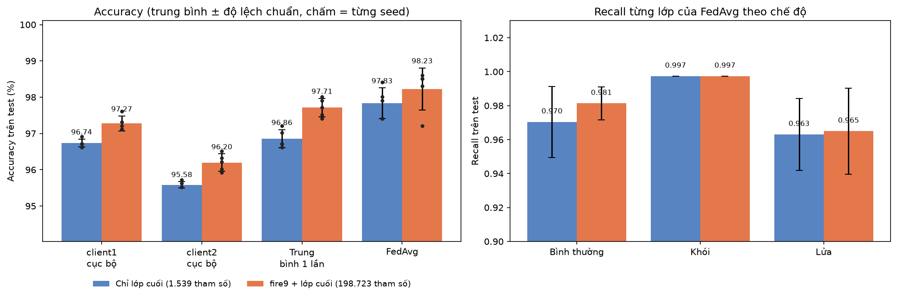

# Báo cáo so sánh nhiều seed: hai chế độ finetune và học liên kết

## 1. Mục tiêu và phạm vi

Các báo cáo trước chỉ dùng một seed, nên chênh lệch dưới 1 điểm giữa các phương pháp chưa đủ bằng chứng. Báo cáo này lặp lại toàn bộ quy trình (huấn luyện cục bộ, trung bình trọng số một lần, FedAvg) với 5 seed và hai chế độ finetune, để trả lời:

1. FedAvg có tốt hơn hai mô hình cục bộ và trung bình một lần một cách nhất quán không?
2. Huấn luyện thêm khối `fire9` (198.723 tham số) có đáng so với chỉ lớp cuối (1.539 tham số) không?
3. Kết quả ổn định đến mức nào giữa các lần chạy?

Câu trả lời cho câu 2 quyết định hướng thiết kế tiếp theo: số tham số được huấn luyện quyết định số ciphertext khi mã hóa đồng cấu (1 ciphertext cho 1.539 tham số, 49 ciphertext cho 198.723 tham số).

## 2. Thiết lập

| Tham số | Giá trị |
|---|---|
| Dữ liệu, chia tập, mô hình nền | Như báo cáo dữ liệu và báo cáo huấn luyện (SqueezeNet 1.1 đóng băng, ảnh 128 × 128, 3 lớp) |
| Hai chế độ finetune | `classifier` (chỉ lớp phân loại cuối, 1.539 tham số) và `fire9_classifier` (khối `fire9` cộng lớp phân loại, 198.723 tham số) |
| Seed | 42, 43, 44, 45, 46 (mỗi seed đổi cách khởi tạo lớp phân loại và thứ tự lô dữ liệu; cách chia tập và tập test giữ nguyên) |
| Huấn luyện cục bộ | 30 epoch (thay vì 150, vì val loss đã đứng yên từ khoảng epoch 30 do tốc độ học về 0; kết quả cục bộ của seed 42 gần như không đổi so với 150 epoch) |
| FedAvg | 20 vòng, 1 epoch cục bộ mỗi vòng, trọng số n_k/n, mô hình cuối là vòng 20 |
| Trình tối ưu | SGD, lr 0,01, không momentum, không weight decay; huấn luyện cục bộ dùng StepLR (bước 7, hệ số 0,1), FedAvg dùng lr không đổi |
| Đánh giá | Một lần trên tập test chung 1.005 ảnh, không chọn mô hình theo test |
| Môi trường | `python src/model/run_experiments.py` tự áp giả lập Pi 4; cả lượt chạy (10 cặp chế độ × seed) mất 1.977 giây thực, 2.682 giây CPU (trung bình 1,36 nhân), RAM vật lý đỉnh 1.273 MiB, bộ nhớ cam kết đỉnh 2.262 MiB (bằng chứng `outputs/device_runs/run_experiments_<giờ>/`) |

Bốn mô hình được so sánh trong mỗi cặp (chế độ, seed): client1 cục bộ, client2 cục bộ, trung bình trọng số một lần của hai mô hình cục bộ, và FedAvg.

## 3. Kết quả

### 3.1 Bảng tổng hợp (trung bình ± độ lệch chuẩn qua 5 seed)

| Chế độ | Mô hình | Accuracy (%) | Macro-F1 | Recall bình thường | Recall khói | Recall lửa | Ảnh sai |
|---|---|---|---|---|---|---|---|
| classifier | client1 cục bộ | 96,74 ± 0,11 | 0,966 ± 0,001 | 0,981 ± 0,003 | 0,997 ± 0,000 | 0,917 ± 0,002 | 32,8 ± 1,1 |
| classifier | client2 cục bộ | 95,58 ± 0,09 | 0,956 ± 0,001 | 0,970 ± 0,002 | 0,936 ± 0,001 | 0,966 ± 0,005 | 44,4 ± 0,9 |
| classifier | Trung bình 1 lần | 96,86 ± 0,25 | 0,968 ± 0,002 | 0,985 ± 0,002 | 0,976 ± 0,006 | 0,943 ± 0,003 | 31,6 ± 2,5 |
| classifier | **FedAvg** | **97,83 ± 0,42** | 0,977 ± 0,005 | 0,970 ± 0,021 | 0,997 ± 0,000 | 0,963 ± 0,021 | 21,8 ± 4,3 |
| fire9_classifier | client1 cục bộ | 97,27 ± 0,21 | 0,971 ± 0,002 | 0,992 ± 0,003 | 0,997 ± 0,000 | 0,924 ± 0,004 | 27,4 ± 2,1 |
| fire9_classifier | client2 cục bộ | 96,20 ± 0,24 | 0,962 ± 0,002 | 0,973 ± 0,003 | 0,945 ± 0,004 | 0,972 ± 0,003 | 38,2 ± 2,4 |
| fire9_classifier | Trung bình 1 lần | 97,71 ± 0,25 | 0,976 ± 0,002 | 0,988 ± 0,004 | 0,988 ± 0,006 | 0,954 ± 0,004 | 23,0 ± 2,5 |
| fire9_classifier | **FedAvg** | **98,23 ± 0,58** | 0,981 ± 0,006 | 0,981 ± 0,010 | 0,997 ± 0,000 | 0,965 ± 0,025 | 17,8 ± 5,8 |

Độ lệch chuẩn là độ lệch chuẩn mẫu (5 seed).



*Hình 1. Accuracy trên test của bốn mô hình ở hai chế độ finetune (cột: trung bình, thanh: độ lệch chuẩn, chấm: từng seed; trục tung cắt từ 94%) và recall từng lớp của FedAvg (phải).*

### 3.2 Kiểm định theo cặp seed

Vì hai mô hình ở cùng seed cùng điều kiện khởi tạo, chênh lệch được tính theo cặp seed. Với 5 seed (4 bậc tự do), giá trị t cần vượt 2,78 để có ý nghĩa ở mức 5% và 4,60 ở mức 1% (kiểm định hai phía, không hiệu chỉnh cho việc so sánh nhiều cặp).

| So sánh | Chênh lệch accuracy trung bình | Số seed thắng | t | Kết luận |
|---|---|---|---|---|
| classifier: FedAvg so với client1 | +1,09 điểm | 5/5 | 4,78 | Có ý nghĩa (1%) |
| classifier: FedAvg so với client2 | +2,25 điểm | 5/5 | 14,13 | Có ý nghĩa (1%) |
| classifier: FedAvg so với trung bình 1 lần | +0,98 điểm | 5/5 | 5,36 | Có ý nghĩa (1%) |
| fire9_classifier: FedAvg so với client1 | +0,96 điểm | 5/5 | 4,04 | Có ý nghĩa (5%) |
| fire9_classifier: FedAvg so với client2 | +2,03 điểm | 5/5 | 9,25 | Có ý nghĩa (1%) |
| fire9_classifier: FedAvg so với trung bình 1 lần | +0,52 điểm | 4/5 | 2,53 | Không có ý nghĩa (5%) |
| client1 cục bộ: fire9 so với classifier | +0,54 điểm | 5/5 | 4,63 | Có ý nghĩa (1%) |
| client2 cục bộ: fire9 so với classifier | +0,62 điểm | 5/5 | 6,39 | Có ý nghĩa (1%) |
| Trung bình 1 lần: fire9 so với classifier | +0,86 điểm | 5/5 | 7,37 | Có ý nghĩa (1%) |
| **FedAvg: fire9 so với classifier** | **+0,40 điểm** | 4/5 | 2,03 | **Không có ý nghĩa (5%)** |

## 4. Phân tích

### 4.1 FedAvg tốt hơn mô hình cục bộ một cách nhất quán

Ở cả hai chế độ, FedAvg thắng cả hai mô hình cục bộ ở 5/5 seed. Với chế độ lớp cuối, FedAvg hơn client1 khoảng 1,1 điểm và hơn client2 khoảng 2,3 điểm, số ảnh sai giảm từ 33 và 44 xuống khoảng 22. Đây là kết quả đã được xác nhận bằng nhiều seed, không còn chỉ là ấn tượng từ một lần chạy.

### 4.2 FedAvg hơn trung bình một lần (cập nhật nhận định trước)

Báo cáo FedAvg dùng một seed nên kết luận chênh lệch giữa FedAvg và trung bình một lần "chưa đủ để khẳng định". Với 5 seed, ở chế độ lớp cuối FedAvg hơn trung bình một lần khoảng 1,0 điểm ở cả 5 seed (t = 5,36), tức các vòng liên kết có ích thật. Ở chế độ `fire9` chênh lệch nhỏ hơn (0,5 điểm, 4/5 seed, t = 2,53) và chưa đủ ý nghĩa. Lý giải: khi nhiều tham số hơn, trung bình một lần đã gần mốc tốt, còn khoảng cách còn lại nhỏ.

### 4.3 Huấn luyện thêm `fire9` có đáng không

- Với mô hình cục bộ và trung bình một lần, `fire9` cải thiện đều và có ý nghĩa: khoảng 0,5 đến 0,9 điểm ở 5/5 seed.
- Với FedAvg, cải thiện chỉ 0,40 điểm (97,83% lên 98,23%), 4/5 seed và **chưa có ý nghĩa ở mức 5%** (t = 2,03). Seed 46 cho kết quả `fire9` thấp hơn (97,21% so với 97,41%).
- Nghĩa là về độ chính xác của mô hình cuối, tăng số tham số huấn luyện lên 129 lần (từ 1.539 lên 198.723) chỉ mang lại lợi ích nhỏ, chưa chắc chắn. Về chi phí, 1.539 tham số vừa một ciphertext, còn 198.723 tham số cần 49 ciphertext.

### 4.4 FedAvg dao động giữa các seed nhiều hơn mô hình cục bộ

Độ lệch chuẩn accuracy của FedAvg (0,42 và 0,58 điểm) lớn hơn nhiều so với mô hình cục bộ (0,09 đến 0,24 điểm). Recall từng lớp của FedAvg cũng dao động mạnh (độ lệch chuẩn khoảng 0,02 với bình thường và lửa).

Nhìn vào từng seed thấy hai lớp này **đánh đổi với nhau**: seed cho recall bình thường cao thì recall lửa thấp và ngược lại. Ví dụ chế độ lớp cuối: seed 46 có recall bình thường 0,994 nhưng lửa 0,927; seed 44 có bình thường 0,939 nhưng lửa 0,981. Chế độ `fire9` có seed 46 tương tự (0,994 và 0,920) và cũng là seed kém nhất (97,21%, 28 ảnh sai). Nguyên nhân khả dĩ: mô hình cuối lấy ở vòng cuối với tốc độ học 0,01 không giảm, nên ranh giới quyết định giữa lớp bình thường và lớp lửa tiếp tục dao động từ vòng này sang vòng khác (đã thấy ở biểu đồ theo vòng của báo cáo FedAvg). Cách giảm dao động: giảm tốc độ học theo vòng, hoặc lấy trung bình trọng số của vài vòng cuối. Đây là hướng cải thiện, chưa được thử.

### 4.5 Điểm yếu còn lại

- **Lớp khói** đạt recall 0,997 ở mọi seed và cả hai chế độ (khoảng 379 trên 380 ảnh): lớp này đã bão hòa. Việc cùng một con số ở mọi seed gợi ý có thể là cùng một ảnh bị sai (có thể là ảnh nhãn đáng ngờ); cần mở `errors.csv` để kiểm tra.
- **Lớp lửa** là lớp yếu nhất của FedAvg (recall khoảng 0,963 đến 0,965) và vẫn không vượt mô hình client2 cục bộ (0,966 đến 0,972), client có nhiều ảnh lửa nhất. FedAvg cải thiện lửa so với client1 nhưng chủ yếu bù lại bằng việc làm lớp bình thường kém đi (recall bình thường FedAvg 0,970 so với 0,985 của trung bình một lần ở chế độ lớp cuối).

### 4.6 Kết quả cục bộ ổn định

Mô hình cục bộ hầu như không đổi giữa các seed (độ lệch chuẩn accuracy 0,09 đến 0,24 điểm). Điều này phù hợp với bản chất bài toán: lớp phân loại tuyến tính trên đặc trưng cố định hội tụ về cùng một nghiệm gần như bất kể khởi tạo. Kết quả huấn luyện 30 epoch (96,74% và 95,58%) gần với kết quả 150 epoch ở báo cáo huấn luyện (96,72% và 95,52%), xác nhận việc giảm số epoch không ảnh hưởng.

## 5. Hạn chế

1. **Chỉ 5 seed (4 bậc tự do).** Kiểm định t trên mẫu nhỏ có độ tin cậy hạn chế; chênh lệch có t quanh 2 đến 3 (như FedAvg so với trung bình một lần ở chế độ `fire9`, hoặc `fire9` so với `classifier` ở FedAvg) nên coi là gợi ý, chưa phải bằng chứng chắc chắn. Không hiệu chỉnh cho việc so sánh nhiều cặp.
2. **Seed chỉ đổi khởi tạo lớp phân loại và thứ tự lô.** Cách chia tập train, val, test giữ nguyên, nên độ lệch chuẩn không phản ánh biến động do chọn tập dữ liệu khác. Độ không chắc chắn thật lớn hơn.
3. **Tập test không độc lập hoàn toàn với train** (khung hình khói liên tiếp từ cùng camera), nên mọi con số có thể lạc quan hơn khả năng tổng quát; nhiễu nhãn ở lớp lửa như đã nêu ở báo cáo huấn luyện.
4. **Cấu hình rút gọn:** huấn luyện cục bộ 30 epoch và FedAvg 20 vòng để tiết kiệm thời gian; hai cấu hình này đã được kiểm tra là không làm thay đổi kết luận ở seed 42 nhưng chưa kiểm tra lại cho mọi seed.
5. **Mô hình FedAvg cuối lấy ở vòng cuối** nên chịu dao động giữa các vòng (mục 4.4); chưa thử giảm tốc độ học theo vòng.
6. Chưa có mã hóa và kênh UAV; kết quả chỉ cho thấy ảnh hưởng của thuật toán. Lượt chạy nằm trong giả lập Pi 4 (1,6 nhân, trần bộ nhớ commit 4 GB; chỉ giới hạn số nhân và RAM, không làm CPU chậm như Pi thật), nhưng hai client chạy lần lượt trong MỘT tiến trình nên dùng chung một giới hạn.

## 6. Kết luận và hệ quả thiết kế

- FedAvg tốt hơn mô hình cục bộ và trung bình một lần một cách nhất quán, có ý nghĩa thống kê ở chế độ lớp cuối (5/5 seed): 97,83% so với 96,74%, 95,58% và 96,86%.
- Huấn luyện thêm `fire9` cải thiện mô hình cục bộ rõ rệt (khoảng 0,6 điểm) nhưng chỉ cải thiện FedAvg khoảng 0,4 điểm (t = 2,03), chưa có ý nghĩa thống kê, trong khi tăng số tham số truyền mỗi vòng 129 lần.
- Kết quả cuối của FedAvg dao động giữa các seed (độ lệch chuẩn 0,4 đến 0,6 điểm) do đánh đổi giữa lớp bình thường và lớp lửa ở vòng cuối.
- **Hệ quả cho thiết kế:** về độ chính xác, chế độ lớp cuối (đúng với bài báo Priv-FedTL) là đủ. Với 1.539 tham số, mã hóa đồng cấu cả phần được huấn luyện chỉ cần 1 ciphertext, nên mã hóa chọn lọc theo tỷ lệ không còn ý nghĩa ở chế độ này. Nếu đề án muốn giữ đóng góp mã hóa chọn lọc và xáo trộn, cần dùng chế độ `fire9` (49 ciphertext) và chấp nhận lợi ích độ chính xác chỉ khoảng 0,4 điểm, hoặc dùng `fire9` như phần mở rộng so sánh. Quyết định này thuộc về thiết kế đề án và cần được chốt trước khi dựng testbed.

## Phụ lục: cách chạy lại

```
python src/model/run_experiments.py
```

Các tham số (seed, chế độ finetune, số epoch cục bộ, số vòng) chỉnh ở mục `experiments` trong `src/model/config.yaml`. Kết quả ở `outputs/model/experiments/so_sanh/`: `summary.md`, `summary.csv`, `results.csv` (từng seed), `comparison.png`; kết quả chi tiết từng lượt chạy ở `<chế độ>/seed<N>/`. Lượt chạy bị dừng giữa chừng có thể chạy tiếp, các seed đã xong được bỏ qua.
